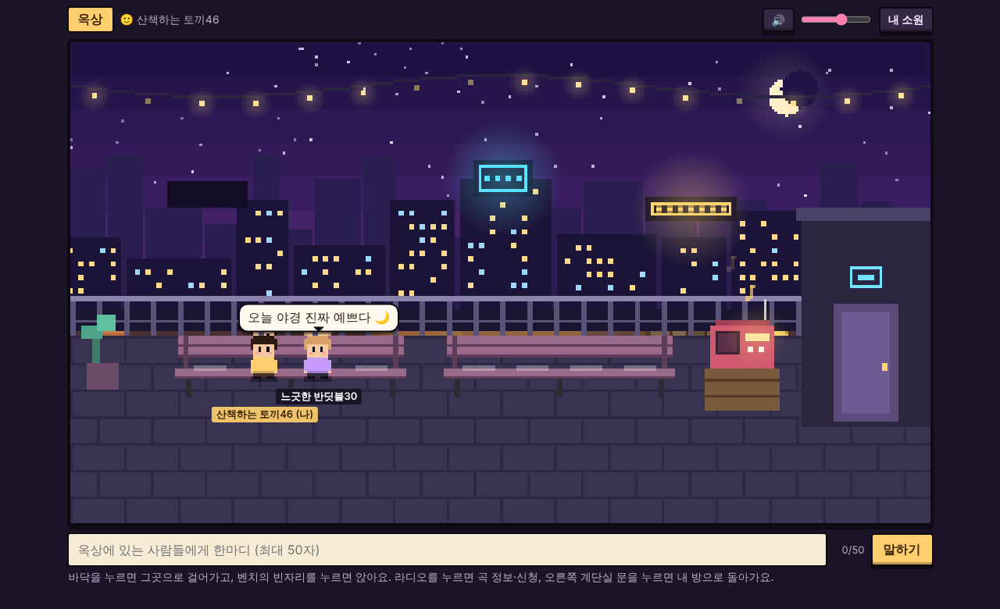
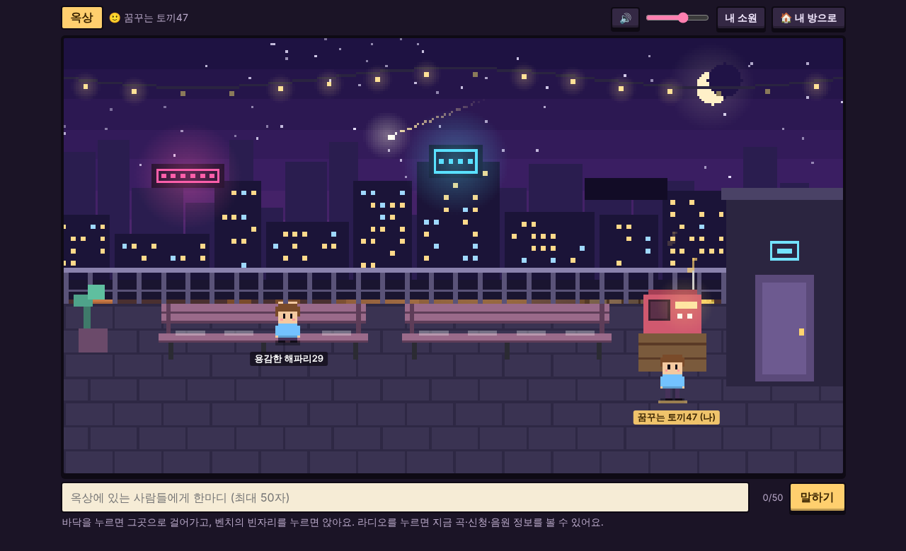
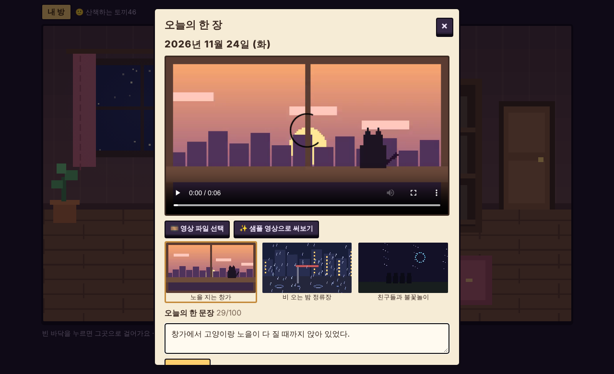
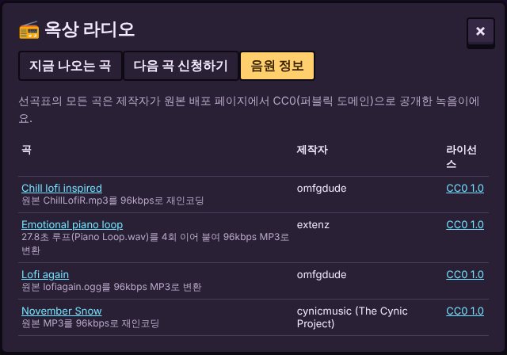
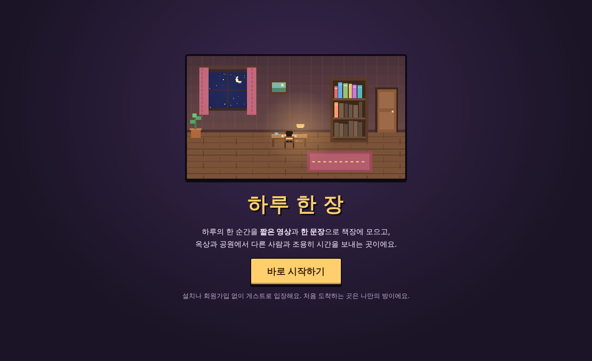
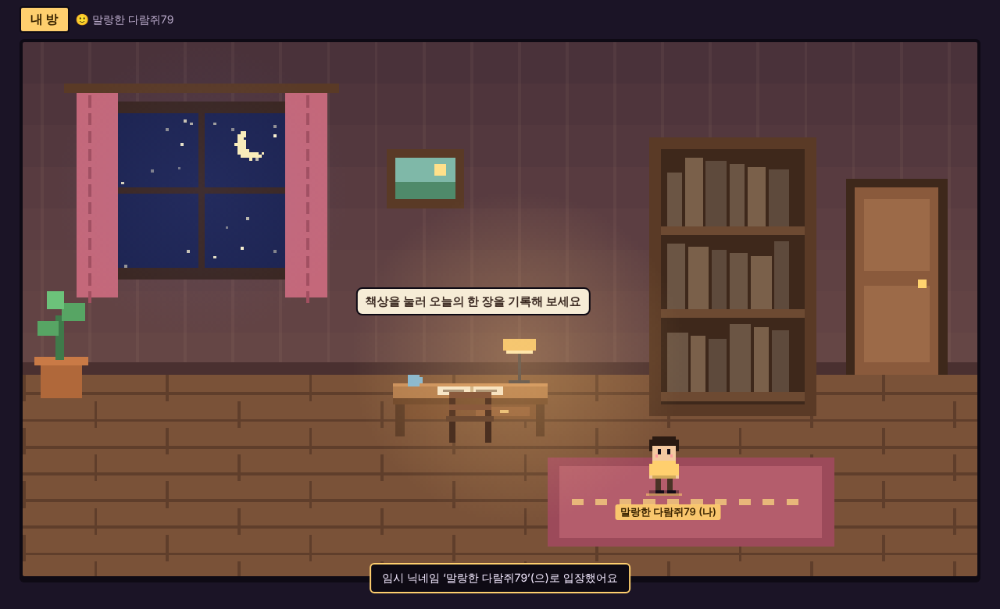
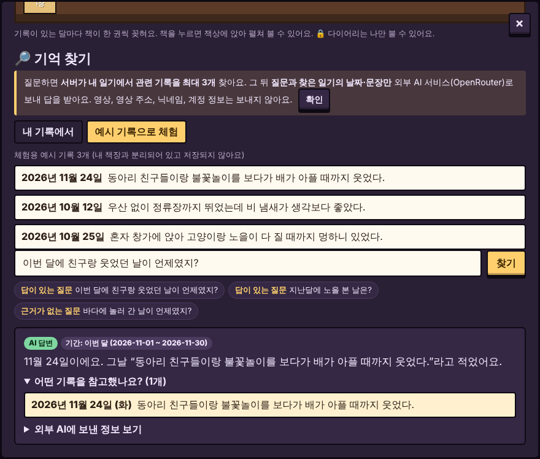

# 하루 한 장

> 하루의 한 순간을 영상과 한 문장으로 책장에 모으고, 옥상과 공원에서 다른 사람과 시간을 보내는 온라인 공간입니다.

| 바로가기 | 상태 |
|---|---|
| 🌐 **배포 사이트** | ⏳ **배포 전** — 배포 설정(Dockerfile·fly.toml·render.yaml)은 준비되어 있고, 배포 후 검증한 실제 주소로 이 칸을 갱신합니다. |
| 📦 GitHub 저장소 | <https://github.com/isoomin2003-gif/business-agent2> |
| 💻 로컬 체험 | `npm install && npm start` → <http://localhost:3000> ([실행 방법](#5-기술-구성과-실행-방법)) |
| 🧠 수업 내용 적용 | 책장의 **‘기억 찾기’** = 7주차 RAG + 5주차 OpenRouter API ([설명](#4-수업-내용-적용--기억-찾기)) |


---

## 1. 프로젝트 소개

- 설치나 회원가입 없이 **‘바로 시작하기’** 한 번이면 게스트 계정과 임시 닉네임이 생기고, 각자의 **방**에서 시작합니다.
- **책상**에서 오늘 가장 기억에 남는 영상 하나와 한 문장을 남기면, 달마다 한 권씩 **책장**에 책이 꽂힙니다.
- 문을 열고 **옥상**(네온 야경 · 라디오 · 짧은 대화)이나 **공원**(말없이 쉬기 · 자연음 · 소원 나무)으로 나가 다른 사람과 같은 시간을 보냅니다.
- 따뜻한 2D 픽셀 아트. 캐릭터·배경은 모두 이 프로젝트에서 코드로 직접 그린 독자 디자인입니다.

## 2. 3분 체험 방법

**① 개인 기록 체험 (1분)**
`바로 시작하기` → 방의 **책상** 클릭(아바타가 의자에 앉음) → `✨ 샘플 영상으로 써보기`에서 영상 선택 → 한 문장 작성 → `저장하기`(처음 한 번 게스트 기록 안내 확인) → `📚 책장에서 보기` → 영상 재생. 새로고침 후 **책장 → 해당 월의 책**에서도 같은 영상이 열립니다.

**② 수업 기능 체험 (1분)**
방의 **책장** 클릭 → 아래 **🔎 기억 찾기** → `예시 기록으로 체험` → 질문 칩 `이번 달에 친구랑 웃었던 날이 언제였지?` 클릭 → 답변 아래 `어떤 기록을 참고했나요?` 펼치기 → 기록을 눌러 원본 페이지 열기. 같은 화면의 `바다에 놀러 간 날이 언제였지?`(근거 없는 질문)도 눌러 보세요.

**③ 다중 접속 체험 (1분)**
일반 창과 **시크릿 창**에서 각각 `바로 시작하기` → 두 창 모두 방의 **문** → `옥상` 선택(인원수가 실시간으로 바뀜) → 벤치의 빈자리를 눌러 나란히 앉기 → 아래 입력창에 한마디(최대 50자) → 두 화면 모두 그 아바타 머리 위에 말풍선 → **라디오** 클릭 → `다음 곡 신청하기`.

## 3. 주요 화면과 기능

| 화면 | 사용자가 할 수 있는 일 |
|---|---|
| 🏠 **내 방** | 책상(‘다이어리 쓰기’) · 책장(‘내 책장’) · 문(‘밖으로 나가기’)에 마우스를 올리면 안내가 뜨고, 누르면 아바타가 걸어가 해당 기능을 엽니다. |
| ✍️ **오늘의 한 장** | PC에서는 영상 파일 선택, 모바일에서는 갤러리 선택·직접 촬영, 또는 샘플 영상 → 한 문장 → 저장. 하루 한 페이지, 오늘 페이지는 다시 열어 수정. 선택 취소·업로드 실패 시 문장 유지. |
| 📚 **월별 책장** | 기록이 있는 달마다 책 한 권. 책을 고르면 책상에 앉아 펼쳐지고, 페이지마다 날짜·문장·영상(재생), 이전/다음 페이지. 🔒 본인만 열람. |
| 🌃 **옥상** | 정해진 지점/벤치 좌석을 눌러 이동·착석, 50자 말풍선 대화, 모두 같은 곡·같은 지점을 듣는 라디오(개인 음량·음소거), 선곡표에서 다음 곡 신청, 음원 정보 확인. |
| 🌳 **공원** | 음악·채팅 없이 조용히 함께 쉬기. 걸을 때 발소리, 벤치에선 풀벌레·바람 소리. 소원 나무를 누르면 공개 소원 읽기/걸기, 공감·응원. |
| 🌠 **별똥별** | 서버가 장소별로 정한 같은 순간에 모두에게 지나감 → ‘소원 빌기’(공개/비공개, 공원에선 ‘소원 나무에도 걸기’). 공개 소원은 머리 위 ✦를 눌러 읽고 반응. |
| 🔎 **기억 찾기** | 책장에서 자연어로 질문 → 내 일기에서 근거를 찾아 AI가 한두 문장으로 답하고, 근거 기록과 원본 페이지로 연결. |

| 두 아바타가 함께 있는 옥상 | 같은 순간의 별똥별 |
|---|---|
|  |  |
| **공원 벤치** | **소원 나무** |
|  |  |
| **오늘의 한 장 작성** | **라디오 음원 정보** |
|  |  |

<details><summary>그 밖의 화면 (첫 화면 · 내 방 · 모바일)</summary>




</details>

> 스크린숏은 예시 데이터로 실제 화면을 Playwright로 촬영했습니다. 두 아바타 화면은 서로 다른 두 브라우저 세션(일반 창/시크릿 창과 같은 분리)으로 찍었습니다.

## 4. 수업 내용 적용 — ‘기억 찾기’

**7주차 RAG(검색 증강 생성)** 를 개인 영상 다이어리에, **5주차 OpenRouter API** 를 답변 생성에 적용했습니다. 핵심 원칙은 “**내 기록은 서버 안에서 찾고, 외부에는 근거로 쓸 최소한만 보낸다**”입니다.



> 위 화면의 AI 답변은 API 키 없이 촬영하려고 **테스트용 OpenRouter 모의 서버**(`test/mock-openrouter.js`)의 응답을 받은 것입니다. 실제 서비스에서는 같은 요청이 OpenRouter로 갑니다.

### 예시 질문 하나 따라가기: “이번 달에 친구랑 웃었던 날이 언제였지?”

| 단계 | 일어나는 일 | 코드 |
|---|---|---|
| **1. 검색 (Retrieval)** | ① `이번 달` → 날짜 범위 `2026-11-01 ~ 2026-11-30` 로 먼저 거름 ② 남은 질문에서 조사·어미·불용어를 떼고(`친구랑`→`친구`, `웃었던`→`웃`) 동의어(웃→재밌·즐거…, 친구→동기·동아리…)를 약하게 확장 ③ **현재 사용자의 일기만** 한국어 문자 n-gram(1·2글자) **BM25** 로 점수화해 **최대 3개** 선택. 관련 기록이 적으면 찾은 만큼만 사용. 전체 일기는 외부로 보내지 않습니다. | `server/rag.js` `retrieve()` |
| **2. 근거 전달 (Augmentation)** | 서버가 **질문 + 검색된 일기의 날짜·문장**만 담아 OpenRouter `chat/completions` 호출. 영상 파일·영상 주소·닉네임·계정 정보·기록 ID는 넣지 않음. 화면의 `외부 AI에 보낸 정보 보기`에서 실제 전송 내용을 확인할 수 있음. | `buildPayload()` |
| **3. 답변 생성 (Generation)** | 시스템 프롬프트: “주어진 기록만 근거로 한국어 한두 문장, 날짜는 M월 D일, 답할 수 없으면 `NO_ANSWER`”. 결과 아래 `어떤 기록을 참고했나요?`에 실제 날짜와 원문, 누르면 해당 페이지(영상 포함)가 열림. | `generateAnswer()`, `public/js/ui/bookshelf.js` |

실제로 OpenRouter로 나가는 사용자 메시지 예:
```
오늘 날짜: 2026-11-24
질문: 이번 달에 친구랑 웃었던 날이 언제였지?

일기 기록:
[1] 2026-11-24 — 동아리 친구들이랑 불꽃놀이를 보다가 배가 아플 때까지 웃었다.
```

### 상황별 동작

| 상황 | 동작 |
|---|---|
| 근거 있음 + AI 정상 | `AI 답변` 배지 + 한두 문장 답 + 참고 기록(날짜·원문) → 원본 페이지 |
| **관련 기록 없음** | 외부 AI를 **호출하지 않고** “관련 기록을 찾지 못했어요” 안내 (해당 기간에 기록이 없으면 그 기간을 알려줌) |
| AI가 근거로 답할 수 없다고 판단 | “기록에서 답을 찾지 못했어요” + 검색된 기록은 열람 가능 |
| **API 키 없음** | `AI 연결 안 됨 · API 키 없음` 배지, 검색된 기록은 그대로 열람 가능 |
| **API 호출 실패**(오류 응답·네트워크·20초 시간 초과) | `AI 연결 실패` 배지와 응답 코드, 검색된 기록은 그대로 열람 가능 |
| 어느 경우든 | 다이어리 작성·열람은 AI 상태와 무관하게 동작 |

- **첫 이용 안내**: 검색창 바로 위에 “질문과 찾은 일기의 날짜·문장만 OpenRouter로 보내고 영상·닉네임·계정 정보는 보내지 않는다”는 안내를 표시합니다.
- **예시 기록으로 체험**: 날짜·내용이 다른 예시 3개(오늘 / 지난달 12일 / 지난달 25일)를 개인 기록과 분리해 두고, 예시에서도 같은 검색과 API 호출을 거칩니다. 답이 있는 질문(`이번 달에 친구랑 웃었던 날…`, `지난달에 노을 본 날은?`)과 근거가 없는 질문(`바다에 놀러 간 날…`)을 버튼으로 바로 시험할 수 있습니다.
- **API 키 관리**: `OPENROUTER_API_KEY` 는 서버 환경변수로만 읽고 브라우저로 전달하지 않습니다.

### 발표 때 RAG 시연 순서
1. 책장 → 기억 찾기 → `예시 기록으로 체험` → 예시 기록 3개를 먼저 보여 줌
2. `이번 달에 친구랑 웃었던 날이 언제였지?` → 답변 → `어떤 기록을 참고했나요?` 펼치기 → 기록 클릭으로 원본 페이지(영상) 열기
3. `외부 AI에 보낸 정보 보기`로 날짜·문장만 전송됨을 확인
4. `바다에 놀러 간 날이 언제였지?` → “관련 기록을 찾지 못했어요”(외부 호출 없음)
5. (선택) API 실패 상황: 로컬에서 `OPENROUTER_BASE_URL=http://localhost:3300/fail/api/v1` 과 모의 서버로 실행하면 `AI 연결 실패` 상태를 재현할 수 있습니다(아래 테스트 방법 참고).

## 5. 기술 구성과 실행 방법

### 사용 기술
| 영역 | 기술 |
|---|---|
| 서버 | Node.js 22 (ESM), Express 4, Socket.IO 4 (실시간 접속·이동·말풍선·라디오·별똥별), Multer 2 (영상 업로드) |
| 데이터베이스 | **SQLite** — Node 내장 `node:sqlite` (네이티브 빌드 불필요), `migrations/*.sql` 자동 적용 |
| 영상 저장소 | 서버의 `DATA_DIR/videos/<사용자ID>/` (공개 폴더 밖). 인증 쿠키로 소유자를 확인한 뒤에만 Range 스트리밍 |
| 프런트엔드 | 빌드 도구 없는 바닐라 JS 모듈 + Canvas 2D 픽셀 아트(320×180 → 정수 배율 확대), 공원 자연음은 Web Audio로 합성 |
| AI | OpenRouter Chat Completions (기본 모델 `anthropic/claude-haiku-5.5`, 환경변수로 변경) |
| 테스트 | `node:test`(서버·RAG 11개), Playwright(브라우저 시나리오 — 개발 중 실행) |

### 필요한 프로그램
- **Node.js 22.13 이상** (`node:sqlite` 사용, 개발·검증은 22.23.5) · npm 10 이상
- 브라우저: 최신 Chrome / Edge / Safari / Firefox

### 새 환경에서 실행
```bash
git clone https://github.com/isoomin2003-gif/business-agent2 haru-hanjang
```
```bash
cd haru-hanjang
```
```bash
npm install
```
```bash
cp .env.example .env
```
```bash
npm start
```
브라우저에서 <http://localhost:3000> 을 엽니다. 첫 실행 때 `data/haru.sqlite` 가 만들어지고 마이그레이션이 자동 적용됩니다(`npm run migrate` 로 따로 실행 가능). 테스트는 `npm test`.

> 로컬에서는 `NODE_ENV` 를 비워 두세요. `NODE_ENV=production` 이면 게스트 쿠키에 `Secure` 가 붙어 **HTTPS에서만** 동작합니다(배포 환경용).

### 환경변수 (`.env.example` 기준)
| 이름 | 용도 | 설정 위치 |
|---|---|---|
| `PORT` | 서버 포트 (기본 3000) | 로컬 `.env` / 배포 플랫폼이 자동 지정 |
| `DATA_DIR` | SQLite DB와 업로드 영상 폴더. 배포 시 **영구 볼륨 경로**(`/data`) | `.env` / fly.toml·render.yaml에 지정됨 |
| `PUBLIC_URL` | 배포 주소(OpenRouter `HTTP-Referer` 헤더용, 선택) | 배포 플랫폼 환경변수 |
| `MAX_VIDEO_MB` | 업로드 영상 최대 크기 (기본 80) | `.env` / 플랫폼 |
| `OPENROUTER_API_KEY` | 기억 찾기 답변 생성용 키. **서버에서만 사용** | `.env` / 플랫폼의 **비밀(secret)** 값 |
| `OPENROUTER_MODEL` | 사용할 모델 ID | `.env` / 플랫폼 |
| `OPENROUTER_BASE_URL`, `OPENROUTER_TIMEOUT_MS` | 보통 그대로 둠(테스트용 모의 서버 연결 시에만 변경) | `.env` |
| `ADMIN_KEY` | 발표 시연 도구(`/demo`) 비밀 키. 비우면 시연 기능 꺼짐 | 플랫폼의 **비밀** 값 |
| `STAR_MIN_SEC`, `STAR_MAX_SEC` | 별똥별 자동 발생 간격(초, 장소별 무작위) | `.env` / 플랫폼 |

`.env` 파일, API 키, 시연 키, DB·업로드 영상(`data/`)은 `.gitignore` 로 커밋되지 않습니다.

### 데이터베이스·영상 저장소 초기 설정
별도 설치가 필요 없습니다. 서버가 시작될 때 `DATA_DIR` 아래에 `haru.sqlite`, `videos/`, `tmp/` 를 만들고 마이그레이션을 적용합니다. 배포 환경에서는 이 폴더가 **재시작·재배포 후에도 남도록 영구 볼륨에 연결**해야 합니다.

### 배포 방법
실시간 상태(접속자, 좌석, 라디오 대기열)는 서버 메모리에, DB와 영상은 디스크에 있으므로 **영구 볼륨이 붙은 서버 1대**로 운영합니다(WebSocket 지원 필요 — 정적 호스팅·서버리스는 맞지 않음).

**A. Fly.io (`fly.toml` 포함)**
```bash
fly launch --no-deploy --copy-config
```
```bash
fly volumes create haru_data --size 3
```
```bash
fly secrets set OPENROUTER_API_KEY=<내 키> ADMIN_KEY=<길고 임의의 값> PUBLIC_URL=https://<앱이름>.fly.dev
```
```bash
fly deploy
```

**B. Render (`render.yaml` 포함)** — Render 대시보드 → New → **Blueprint** → 이 저장소 선택. 디스크(`/data`)가 붙는 Starter 이상 플랜이 필요합니다. `OPENROUTER_API_KEY`, `PUBLIC_URL` 은 대시보드에서 입력하고, `ADMIN_KEY` 는 자동 생성된 값을 Environment 탭에서 확인합니다.

두 방식 모두 같은 `Dockerfile`(node:22-slim, `npm ci --omit=dev`)을 사용하고 `/healthz` 로 상태를 확인합니다.

### 두 사용자 테스트 방법
1. 같은 컴퓨터에서 **일반 창**과 **시크릿 창**(또는 서로 다른 브라우저)으로 사이트를 엽니다. 쿠키가 분리되어 서로 다른 게스트가 됩니다.
2. 두 창 모두 `바로 시작하기` → 각자의 방에서 출발 → 문 → `옥상`. 문 화면의 `옥상 · 현재 N명`이 바뀌는 것을 확인합니다.
3. 같은 벤치에 나란히 앉고(같은 좌석을 동시에 누르면 한 명만 앉음), 한쪽에서 말하면 두 화면 모두 그 아바타 위에 말풍선이 뜹니다.
4. 라디오 → `다음 곡 신청하기` → 현재 곡이 끝나면 두 창에서 같은 신청곡이 시작되고 `○○ 님의 신청곡 ♪`이 뜹니다. 한쪽을 음소거해도 다른 쪽은 계속 들립니다.
5. 한쪽이 `내 방으로` → 문 → `공원` 으로 옮기면 인원수가 갱신되고, 그 사람에게는 라디오 대신 발소리·풀벌레·바람 소리가 들립니다.

### 별똥별·신청곡 시연 방법 (발표용)
별똥별은 기본적으로 장소마다 2.5~7분 사이 무작위로 지나갑니다. 발표 때 기다리지 않으려면 **서버에 `ADMIN_KEY` 를 설정**하고, 발표자만 별도 탭에서 `/demo` 페이지를 열어 그 키를 입력합니다.
- `옥상에 별똥별` / `공원에 별똥별`: 약 2.5초 뒤, 그 장소에 있는 모든 화면에 **같은 순간** 별똥별이 지나갑니다.
- `현재 곡 8초 뒤 종료`: 신청곡 시연용으로 현재 곡을 끝부분으로 앞당깁니다.

시연 키 없이는 이 기능이 동작하지 않으며(403), 일반 방문자 화면에는 링크가 없습니다. 실제 키 값은 README나 저장소에 적지 마세요.

### 폴더 구조
```
server/        index.js(라우팅) auth.js(게스트) diary.js(다이어리·영상) realtime.js(Socket.IO)
               radio.js tracks.js(선곡표) wishes.js rag.js·memory.js(기억 찾기) db.js config.js
migrations/    001_init.sql
public/        index.html demo.html css/ js/(main, stage, scenes, ui, audio, shared/places.js) media/
test/          *.test.js, mock-openrouter.js
tools/         make_sample_videos.py (샘플 영상 생성)
docs/screenshots/
```

## 6. 출처와 개발 현황

### 라디오 음원 (모두 CC0 1.0)
제작자가 **원본 배포 페이지에서 CC0로 공개했음을 확인한 곡만** 넣었습니다(확인일 2026-11-24). 앱의 라디오 → `음원 정보` 탭에서도 같은 내용을 볼 수 있습니다.

| 곡 | 제작자 | 장르 | 원본 배포 페이지 | 라이선스 | 비고 |
|---|---|---|---|---|---|
| Chill lofi inspired | omfgdude | 로파이 | <https://opengameart.org/content/chill-lofi-inspired> | [CC0 1.0](https://creativecommons.org/publicdomain/zero/1.0/) | 96kbps 재인코딩 |
| Emotional piano loop | extenz | 피아노 | <https://opengameart.org/content/emotional-piano-loop> | [CC0 1.0](https://creativecommons.org/publicdomain/zero/1.0/) | 27.8초 루프를 4회 이어 붙여 MP3 변환 |
| Lofi again | omfgdude | 로파이 | <https://opengameart.org/content/lofi-again> | [CC0 1.0](https://creativecommons.org/publicdomain/zero/1.0/) | OGG→MP3 변환 |
| November Snow | cynicmusic (The Cynic Project) | 앰비언트 | <https://opengameart.org/content/november-snow> | [CC0 1.0](https://creativecommons.org/publicdomain/zero/1.0/) | 96kbps 재인코딩 (제작자 요청에 따라 크레딧 표기) |

검색 중 찾았지만 CC-BY(저작자 표시 필요)였던 곡(Night Calm, Peaceful 1am in May, Purrple Cat 앨범 등)은 요구 조건에 맞지 않아 **제외**했습니다.

### 그 밖의 자료
| 자료 | 출처 · 이용 조건 |
|---|---|
| 샘플 영상 3개 (`public/media/samples/*.mp4`) | 이 프로젝트에서 직접 만든 픽셀 아트 영상. `tools/make_sample_videos.py`로 다시 만들 수 있음. CC0로 배포 |
| 방·옥상·공원 배경, 아바타, 아이콘 | 이 프로젝트의 코드(`public/js/scenes`, `render/pixel.js`)로 직접 그린 독자 디자인 |
| 공원 발소리·풀벌레·바람 소리 | 녹음 파일 없이 Web Audio로 실시간 합성(`public/js/audio/ambience.js`) |
| 글꼴 | 외부 글꼴 없이 사용자 기기의 한글 시스템 글꼴 사용 |

### 개발 현황
**✅ 실제로 동작을 확인한 기능** (로컬 서버 + Playwright 브라우저 자동화, `npm test` 11개 통과)
- ① 링크 입장 → 다이어리 저장 → 새로고침 → 책장에서 같은 영상 재생 (파일 선택 취소·잘못된 파일 업로드 후 문장 유지 포함)
- ② 분리된 두 브라우저 세션이 각자 방에서 출발해 같은 옥상 벤치에 나란히 앉음, 동시 좌석 클릭 시 한 명만 착석, 말풍선이 두 화면에서 해당 아바타 위에 표시, 51자 거부
- ③ 신청곡이 현재 곡 종료 후 두 화면에서 같은 곡·같은 지점(오차 약 0.05초)으로 시작, 신청곡 알림, 한쪽 음소거 중에도 다른 쪽 재생 지속, 1인 1곡·미등록 곡 ID 거부
- ④ 두 화면의 별똥별 발생 시각 일치, 공개 소원 ✦ 표시, 공원 이동 시 인원수 갱신(옥상 1·공원 1), 이동한 사람은 라디오 정지 + 발소리/풀벌레·바람 소리
- ⑤ 소원 나무 공개 글을 작성자가 떠난 뒤 다른 사용자가 읽고 응원, 벤치에서 쉬는 사람 화면에 자동 표시 안 됨, 다른 사람의 다이어리/영상 접근 404·비로그인 401
- ⑥ 기억 찾기: 근거 있는 답 → 원본 페이지 이동, 관련 기록 없음, API 실패(503), API 키 없음 각각 확인. 실제 openrouter.ai 엔드포인트에 잘못된 키로 요청해 401 → `AI 연결 실패` 처리도 확인
- 모바일(Pixel 7 에뮬레이션): 화면 맞춤, 터치로 책상·문·좌석 선택, ‘직접 촬영’ 버튼 표시
- 프로덕션 모드 설치(`npm ci --omit=dev`)·실행, Secure/HttpOnly 쿠키

**🔧 외부 서비스 설정 후 확인이 필요한 기능**
- 실제 OpenRouter 키로 생성한 답변 품질 (개발 중에는 키가 없어 모의 서버로 요청·응답 경로를 검증)
- 배포 사이트에서의 공개 링크 접속, 영구 볼륨에 저장된 DB·영상 유지, 서로 다른 컴퓨터 간 실시간 접속
- 실제 휴대폰에서의 갤러리 선택·직접 촬영 업로드와 자동재생 정책(‘라디오 켜기’ 버튼)

**🗺️ 후속 개발 계획**
- 코인을 모아 가구를 구매하는 **방 꾸미기**
- AI 책 제목 생성(월별 책 표지), 저장 후 AI 한 줄 코멘트
- 게스트 기록을 다른 기기로 옮기는 계정 연결, 영상 저장소를 S3 호환 스토리지로 분리

---
코드는 MIT 라이선스입니다. 음원·샘플 자료의 조건은 위 표를 따릅니다.
