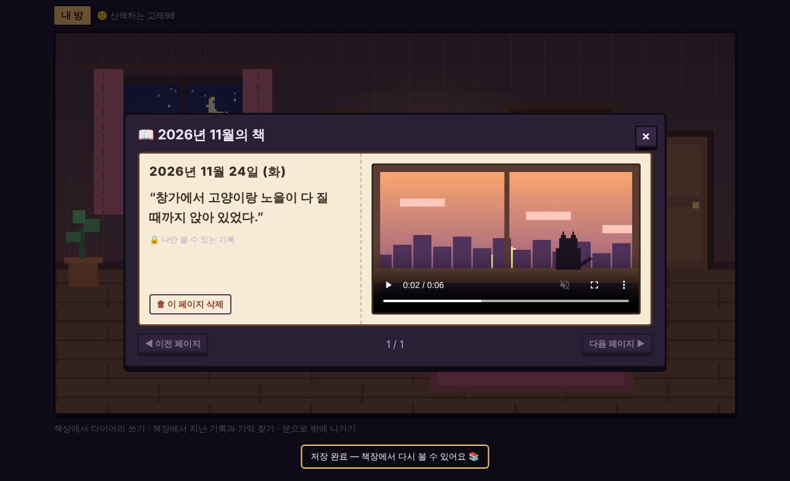
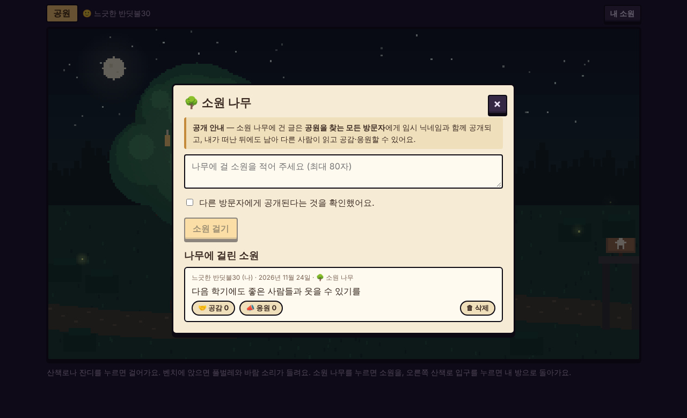
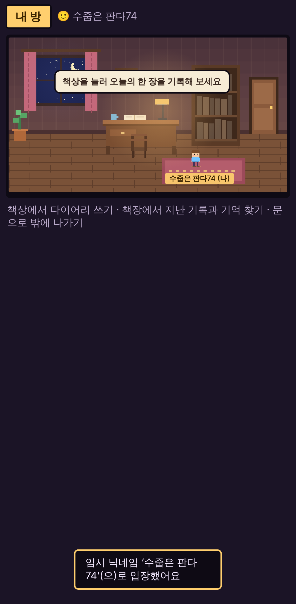
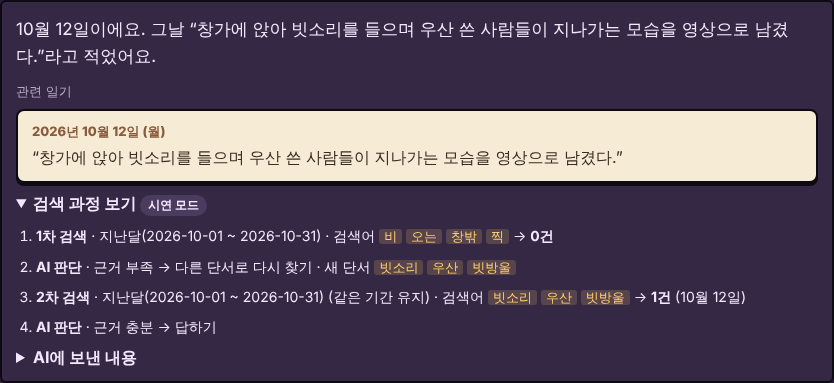
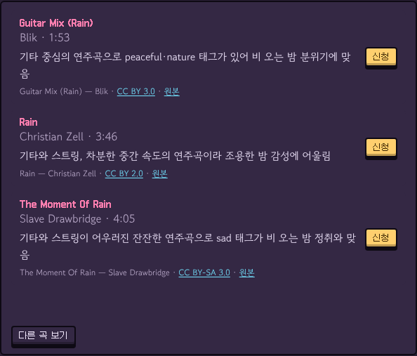

# 하루 한 장

> 하루의 한 순간을 영상과 한 문장으로 책장에 모으고, 옥상과 공원에서 다른 사람과 시간을 보내는 온라인 공간입니다.

| 바로가기 | 상태 |
|---|---|
| 🌐 **배포 사이트** | ✅ **<https://haru-hanjang.onrender.com>** (Render 무료 플랜 + Supabase 저장소, 2026-11-24 접속·두 세션 동작 확인) — 일기·영상·소원은 Supabase에 보관됩니다. [현재 보존 범위](#배포-사이트의-현재-보존-범위) |
| 📦 GitHub 저장소 | <https://github.com/isoomin2003-gif/business-agent2> |
| 💻 로컬 체험 | `npm install && npm start` → <http://localhost:3000> ([실행 방법](#5-기술-구성과-실행-방법)) |
| 📖 이용 방법 | 입장 · 다이어리 · 책장 · 기억 찾기 · 옥상 · 공원 · 별똥별 ([자세한 이용 방법](#자세한-이용-방법)) |
| 🧠 수업 내용 적용 | 책장의 **‘기억 찾기’** = 7주차 RAG + 5주차 OpenRouter API ([설명](#4-수업-내용-적용--기억-찾기)) |



---

## 1. 프로젝트 소개

- 설치나 회원가입 없이 **‘바로 시작하기’** 한 번이면 게스트 계정과 임시 닉네임이 생기고, 각자의 **방**에서 시작합니다.
- **책상**에서 오늘 가장 기억에 남는 영상 하나와 한 문장을 남기면, 달마다 한 권씩 **책장**에 책이 꽂힙니다.
- 문을 열고 **옥상**(네온 야경 · 라디오 · 짧은 대화)이나 **공원**(말없이 쉬기 · 자연음 · 소원 나무)으로 나가 다른 사람과 같은 시간을 보냅니다.
- 따뜻한 2D 픽셀 아트. 캐릭터·배경은 모두 이 프로젝트에서 코드로 직접 그린 독자 디자인입니다.

## 2. 3분 체험 방법

**① 개인 기록 체험 (1분)**
`바로 시작하기` → 방의 **책상** 클릭(아바타가 의자에 앉음) → `✨ 샘플 영상으로 써보기`에서 영상 선택 → 한 문장 작성 → `저장하기`(처음 한 번 게스트 기록 안내 확인) → `📚 책장에서 보기` → 영상 재생. 새로고침 후 **책장 → 해당 월의 책**에서도 같은 영상이 열립니다.

**② 수업 기능 체험 (1분)**
방의 **책장** 클릭 → 아래 **🔎 기억 찾기** → `예시 일기로 체험` → 예시 질문 `지난달에 비 오는 날 창밖을 찍었던 게 언제였지?` 클릭 → 짧은 답과 일기 카드(날짜·문장) 확인 → 카드를 눌러 그날의 영상 페이지 열기. `이번 달에 친구랑 웃었던 날이 언제였지?`, `바다에서 수영한 날이 언제였지?`도 눌러 보세요. 검색 과정(검색어·건수·AI 판단)은 [시연 모드](#검색-과정-보기-시연-모드)에서만 보입니다.

**③ 다중 접속 체험 (1분)**
일반 창과 **시크릿 창**에서 각각 `바로 시작하기` → 두 창 모두 방의 **문** → `옥상` 선택(인원수가 실시간으로 바뀜) → 벤치의 빈자리를 눌러 나란히 앉기 → 아래 입력창에 한마디(최대 50자) → 두 화면 모두 그 아바타 머리 위에 말풍선 → **라디오** 클릭 → `다음 곡 신청하기`.

## 3. 주요 화면과 기능

| 화면 | 사용자가 할 수 있는 일 |
|---|---|
| 🏠 **내 방** | 빈 바닥을 누르면 가구를 돌아 그곳까지 걸어가 멈춤. 책상(‘다이어리 쓰기’) · 책장(‘내 책장’) · 문(‘밖으로 나가기’)에 마우스를 올리면 안내가 뜨고, 누르면 아바타가 걸어가 해당 기능을 엽니다. |
| ✍️ **오늘의 한 장** | PC에서는 영상 파일 선택, 모바일에서는 갤러리 선택·직접 촬영, 또는 샘플 영상 → 한 문장 → 저장. 하루 한 페이지, 오늘 페이지는 다시 열어 수정. 선택 취소·업로드 실패 시 문장 유지. |
| 📚 **월별 책장** | 기록이 있는 달마다 책 한 권. 책을 고르면 책상에 앉아 펼쳐지고, 페이지마다 날짜·문장·영상(재생), 이전/다음 페이지, 🗑 내 페이지 삭제(확인 후 문장·영상 함께 삭제). 🔒 본인만 열람. |
| 🌃 **옥상** | 바닥 타일을 누르면 벤치·라디오를 돌아 그곳까지 걷고(걷는 중 다시 누르면 방향 전환), 벤치 빈자리를 누르면 앉기, 50자 말풍선 대화, 모두 같은 곡·같은 지점을 듣는 라디오(개인 음량·음소거), **🎵 새 노래 추천받기**: 원하는 분위기를 적으면 라디오에 없는 공개 라이선스 곡 3개를 외부 음악 목록에서 찾아 추천(나에게만 표시) → 곡 옆 **신청**, 기본 선곡표에서 신청, 음원 정보(출처·라이선스·저작자 표시) 확인. |
| 🌳 **공원** | 산책로·잔디를 누르면 나무·벤치를 돌아 걸어가기. 음악·채팅 없이 조용히 함께 쉬기. 걸을 때 발소리, 벤치에선 풀벌레·바람 소리. 소원 나무를 누르면 공개 소원 읽기/걸기, 공감·응원. 내가 건 소원은 나무·‘내 소원’에서 🗑 삭제(두 번 눌러 확인). |
| 🌠 **별똥별** | 서버가 장소별로 정한 같은 순간에 모두에게 지나감 → ‘소원 빌기’(공개/비공개, 공원에선 ‘소원 나무에도 걸기’). 공개 소원은 머리 위 ✦를 눌러 읽고 반응. |
| 🔎 **기억 찾기** | 책장에서 자연어로 질문 → 내 일기(지정 기간 안)를 검색 → AI가 근거가 충분하면 답하고, 부족하면 다른 단서로 한 번 더 검색. 결과는 짧은 답과 일기 카드(날짜·문장)만, 카드를 누르면 그날의 영상 페이지. 검색 과정은 발표용 시연 모드에서만 표시. |

| 두 아바타가 함께 있는 옥상 | 같은 순간의 별똥별 |
|---|---|
|  |  |
| **공원 벤치** | **소원 나무** |
|  |  |
| **오늘의 한 장 작성** | **라디오 음원 정보 (16곡, ★ 기본 방송)** |
|  |  |

<details><summary>그 밖의 화면 (첫 화면 · 내 방 · 모바일)</summary>



</details>

> 스크린숏은 예시 데이터로 실제 화면을 Playwright로 촬영했습니다. 두 아바타 화면은 서로 다른 두 브라우저 세션(일반 창/시크릿 창과 같은 분리)으로 찍었습니다.

### 자세한 이용 방법

PC에서는 마우스로, 휴대폰에서는 손가락으로 누르면 됩니다. 한동안 접속이 없었다면 첫 화면이 뜨기까지 1분 정도 걸릴 수 있어요.

#### 입장하기
- 첫 화면의 **바로 시작하기** 위에 지금 쓸 **닉네임**이 보여요. 처음 온 사람은 자동으로 정해진 이름을 그대로 쓰거나, **변경**을 눌러 원하는 이름(최대 12자)으로 바꾼 뒤 **저장**(또는 **취소**)할 수 있어요.
- **바로 시작하기**를 누르면 그 닉네임의 게스트 계정이 생기고 **나만의 방**에 도착해요. 가입은 필요 없어요.
- 내 방 왼쪽 위의 **← 홈으로**를 누르면 게스트 기록은 그대로 둔 채 첫 화면으로 돌아가요. 거기서 닉네임을 바꾸고 **내 방으로 들어가기**를 누르면, 같은 책장과 일기가 그대로 있고 바뀐 이름은 내 이름표와 옥상·공원에서 다른 사람이 보는 이름표에 반영돼요. (← 홈으로는 개인 방에서만 보이고, 야외에서는 옥상 계단실 문이나 공원 입구로 방에 돌아와요.)
- 기록은 **지금 쓰는 브라우저**에 연결돼요. 같은 브라우저로 다시 오면 내 방과 일기가 그대로 있어요.
- 쿠키를 지우거나, 시크릿 창을 닫거나, 다른 기기·브라우저로 들어오면 새 손님이 되어 예전 기록을 열 수 없어요.

#### 내 방
책상·책장·문 사이의 빈 바닥을 누르면 가구를 돌아 그곳까지 걸어가요. 가구에 마우스를 올리면 이름이 뜨고, 누르면 아바타가 걸어가 해당 기능을 열어요.

| 누르는 곳 | 하는 일 |
|---|---|
| 🪑 **책상** | 다이어리 쓰기 |
| 📚 **책장** | 지난 기록 보기, 기억 찾기 |
| 🚪 **문** | 옥상이나 공원으로 나가기 |

#### 오늘의 한 장 쓰기 (책상)
1. 책상을 누르면 아바타가 의자에 앉고 오늘 날짜 페이지가 펼쳐져요.
2. 영상을 하나 골라요.
   - **🎞️ 영상 파일 선택**: PC에 있는 영상
   - **📷 직접 촬영**: 휴대폰에서만 보여요
   - **✨ 샘플 영상으로 써보기**: 영상이 없을 때 준비된 영상 3개 중에서 골라요
3. **오늘의 한 문장**을 적고(100자까지) **저장하기**를 눌러요.
4. **📚 책장에서 보기**를 누르면 방금 쓴 페이지가 열리고 영상을 재생할 수 있어요.

- 하루에 한 페이지예요. 오늘 이미 썼다면 책상에서 다시 열어 고칠 수 있어요.
- 영상 선택을 취소하거나 올리기에 실패해도 적던 문장은 그대로 남아요.
- 영상은 50MB까지 올릴 수 있어요(배포 사이트 기준).

#### 책장
- 기록이 있는 달마다 책이 한 권씩 꽂혀요. 책을 누르면 아바타가 책상에 앉아 책을 펼쳐요.
- **◀ 이전 페이지 / 다음 페이지 ▶**로 넘기며 날짜, 문장, 영상을 볼 수 있어요.
- 지우고 싶은 페이지는 **🗑 이 페이지 삭제 → 삭제**를 눌러요. 문장과 영상이 함께 지워지고 되돌릴 수 없어요.
- 🔒 일기는 나만 볼 수 있어요. 옥상이나 공원에 저절로 공유되지 않아요.

#### 기억 찾기 (책장 아래)
1. 질문을 적어요. 예: “비 오는 날 창밖을 찍었던 게 언제였지?”, “이번 달에 친구랑 웃었던 날이 언제였지?”
2. ‘이번 달’, ‘지난달’처럼 기간을 넣으면 그 안에서만 찾아요.
3. 내 일기에서 찾은 기록을 보고 AI가 답해요. 처음에 못 찾으면 AI가 비슷한 다른 단서(예: 비 → 빗소리, 우산)로 한 번 더 찾아요.
4. 검색하는 동안 ‘일기를 찾고 있어요…’가 보이고, 결과가 나오면 짧은 답과 함께 **일기 카드**(날짜와 내가 쓴 한 문장)가 보여요. 카드를 누르면 그날의 일기 페이지(영상)가 열려요.
5. 두 번 찾아도 없으면 “관련된 기록을 찾지 못했어요”와 함께 다른 단서(함께한 사람, 장소, 날씨 등)로 다시 물어보라는 안내가 나와요. AI 연결에 실패하면 잠시 후 **다시 시도**할 수 있고, 그때까지 찾아 둔 일기 카드는 바로 열 수 있어요.

- 일기가 없다면 **예시 일기로 체험**을 누르고 예시 질문을 눌러 보세요.
- 처음 쓸 때 한 번, 질문과 관련 일기의 날짜·문장이 AI(OpenRouter)로 전송된다는 짧은 안내가 보여요. 영상과 계정 정보는 보내지 않아요.

#### 밖으로 나가기 (문)
방의 문을 누르면 아바타가 문 앞까지 걸어간 뒤, `옥상 · 현재 N명`, `공원 · 현재 N명`처럼 지금 그곳에 있는 사람 수가 보이는 창이 열려요. 각자 방에 있는 사람은 세지 않아요.

- 옥상은 바닥 타일, 공원은 산책로나 잔디를 누르면 그곳까지 걸어가 멈춰요. 벤치·라디오·나무 같은 것은 알아서 돌아가요.
- 걷는 도중 다른 곳을 누르면 그 자리에서 방향을 바꿔요. 내 움직임은 같은 장소에 있는 다른 사람 화면에도 같은 위치로 보여요.
- 벤치의 **빈자리**를 누르면 가서 앉아요. 앉아 있다가 빈 바닥을 누르면 일어나 그곳으로 걸어가요. 두 사람이 같은 자리를 동시에 누르면 한 사람만 앉아요.
- 방으로 돌아갈 때는 **옥상의 계단실 문**이나 **공원 오른쪽 산책로 입구(🏠 표지판)**를 눌러요. 마우스를 올리면 ‘내 방으로’가 보이고, 아바타가 그곳까지 걸어간 뒤 각자의 방으로 돌아가요. 걸어가는 도중 다른 바닥을 누르면 돌아가기가 취소돼요.

#### 🌃 옥상
- 화면 아래 입력창에 한마디를 적으면(50자까지, 이모지 가능) 내 아바타 머리 위에 말풍선이 잠깐 떠요. 같은 옥상에 있는 사람만 볼 수 있어요.
- 라디오는 들어오면 저절로 나오고, 모두 같은 곡의 같은 부분을 들어요.
  - 소리가 안 나면 위쪽의 **📻 라디오 켜기**를 눌러요.
  - 🔊 버튼과 음량 막대는 내 화면에만 적용돼요.
- **라디오**를 누르면 작은 창이 열려요.
  - **지금 나오는 곡**: 곡 정보와 다음 순서
  - **다음 곡 신청하기**: 선곡표에서 골라요. 한 사람당 한 곡까지 기다릴 수 있고, 지금 곡이 끝나면 신청한 순서대로 나와요. 내 곡이 시작되면 라디오 위에 ‘○○ 님의 신청곡 ♪’이 떠요.
  - **🎵 새 노래 추천받기**: `비 오는 밤에 어울리는 잔잔한 기타곡`처럼 원하는 분위기·악기를 적고 **추천받기**를 누르면, 아직 라디오에 없는 곡을 최대 3개 보여 줘요. 곡마다 **제목·아티스트·길이·추천 이유 한 줄·출처와 라이선스**가 있고, 옆의 **신청**을 누르면 대기열에 들어가요.
    - 추천 목록은 나에게만 보이고, 그동안 다른 사람은 계속 라디오를 들어요. **신청**을 눌러야만 모두의 대기열에 들어가요.
    - **다른 곡 보기**: 방금 본 곡을 빼고 다시 추천해요. 맞는 곡이 적으면 찾은 만큼만, 없으면 분위기나 악기를 바꿔 다시 찾을 수 있어요.
    - 다른 사람이 먼저 신청한 곡은 버튼이 **이미 신청됨**으로 바뀌어요.
  - **기본 선곡표 신청**: 기본 16곡 중에서 골라요.
  - **음원 정보**: 기본 16곡과 신청으로 추가된 곡의 제목, 만든 사람, 출처, 라이선스, 저작자 표시

#### 🌳 공원
- 음악과 채팅이 없는 조용한 곳이에요. 걸을 땐 발소리가, 벤치에 앉으면 풀벌레와 바람 소리가 들려요.
- **소원 나무**를 누르면 걸린 소원을 읽고 **🤝 공감**이나 **📣 응원**을 보낼 수 있어요.
- 소원을 걸려면 글을 쓰고 ‘공개된다는 것을 확인했어요’에 체크한 뒤 **소원 걸기**를 눌러요. 나무에 건 소원은 모든 방문자에게 공개되고, 내가 떠난 뒤에도 남아요.

#### 🌠 별똥별 (옥상·공원)
- 가끔 별똥별이 지나가요. 같은 장소에 있는 사람은 모두 같은 순간에 봐요.
- 지나간 뒤 **🌠 소원 빌기** 버튼이 20초 동안 떠요.
  - **비공개**: 나만 볼 수 있어요.
  - **공개**: 내 머리 위에 ✦가 떠요. 함께 있는 사람이 ✦를 눌러 읽고 공감이나 응원을 보낼 수 있어요.
  - 공원에서는 **소원 나무에도 걸기**를 고르면 같은 글이 나무에도 걸려요(공개 소원만).
- 위쪽의 **내 소원**에서 지금까지 빈 소원을 볼 수 있어요. 지우려면 **🗑 삭제**를 두 번 눌러요.

#### 두 사람이 함께 써 보기
1. 같은 컴퓨터에서 **일반 창**과 **시크릿 창**으로 각각 사이트를 열어요. 서로 다른 손님으로 들어가져요.
2. 두 창 모두 **바로 시작하기 → 문 → 옥상**으로 가요.
3. 같은 벤치에 나란히 앉아 한쪽에서 말을 걸면, 두 화면 모두 그 아바타 위에 말풍선이 떠요.

#### 발표자용
- 별똥별을 바로 띄우거나 신청곡 장면을 보여 주려면 [별똥별·신청곡 시연 방법](#별똥별신청곡-시연-방법-발표용)을 참고하세요. 시연 키(`ADMIN_KEY`) 값은 Render의 Environment 탭에서만 확인하고 어디에도 적지 마세요.
- 시연 몇 분 전에 사이트를 열어 깨워 두고, Supabase 프로젝트가 일시정지되지 않았는지 확인하세요([현재 보존 범위](#배포-사이트의-현재-보존-범위)).

## 4. 수업 내용 적용 — ‘기억 찾기’

**7주차 RAG(검색 증강 생성)** 를 개인 영상 다이어리에, **5주차 OpenRouter API** 를 ‘검색 결과를 보고 다음 행동을 고르는 AI’에 적용했습니다. 핵심 원칙은 “**내 기록은 서버 안에서 찾고, 외부에는 근거로 쓸 최소한(질문과 찾은 일기의 날짜·문장)만 보낸다**”입니다.

| 일반 사용자 화면 | 시연 모드 (발표용) |
|---|---|
|  |  |

> **왼쪽**은 배포 사이트에서 실제 OpenRouter(모델 `anthropic/claude-haiku-5.5`)로 `지난달에 비 오는 날 창밖을 찍었던 게 언제였지?`를 물은 **일반 모드** 결과입니다 — 짧은 답과 ‘관련 일기’ 카드만 보입니다. **오른쪽**은 같은 질문을 **시연 모드**로 실행해 검색 과정을 펼친 화면으로, 배포 사이트의 시연 키 없이 촬영하려고 로컬 서버와 테스트용 OpenRouter 모의 서버(`test/mock-openrouter.js`)로 찍었습니다. 배포 사이트에서 실제 모델로 같은 질문을 했을 때의 과정은 아래 표 ②와 같습니다(1차 0건 → 새 단서 `빗소리 우산 빗방울 창문` → 2차 1건 → 답하기).

### 흐름: 검색 → AI가 다음 행동 선택 → (필요하면) 한 번 더 검색 → 답변

| 단계 | 일어나는 일 | 코드 |
|---|---|---|
| **1. 1차 검색 (Retrieval)** | ① 질문의 기간 표현(`이번 달`, `지난달`, `어제`, `N월` …)을 날짜 범위로 바꿔 **먼저 거름** ② 남은 질문에서 조사·어미·불용어를 떼어 검색어를 만듦(`창밖을`→`창밖`, `찍었던`→`찍`) ③ **현재 사용자의 일기만** 한국어 문자 n-gram(1·2글자) **BM25** 로 점수화해 **최대 3개**. 전체 일기는 외부로 보내지 않음 | `server/rag.js` `parseDateRange()` `queryTerms()` `searchPool()` |
| **2. AI 판단 (Augmentation)** | 서버가 **질문 + 검색된 일기의 날짜·문장**만 OpenRouter `chat/completions`로 보냄. AI는 JSON 하나로 다음 행동을 고름: `answer`(근거 충분, 근거 번호 포함) / `retry`(근거 부족 → 질문 뜻을 유지한 새 단서 최대 4개) / `not_found` | `buildAgentPayload()` `parseDecision()` |
| **3. 2차 검색 (1회만)** | AI가 고른 단서로 **사용자가 지정한 기간 그대로** 다시 검색. 2차 결과 + 1차 결과를 최대 3개로 합쳐 AI에 다시 보냄(재검색은 더 허용하지 않음). 다시 찾은 기록이 0건이면 AI에 묻지 않고 종료 | `memorySearch()` |
| **4. 답변 (Generation)** | `answer`면 AI 문장(한두 문장, 날짜는 M월 D일) + **실제 일기 날짜와 원문**을 보여 주고, 누르면 그날의 영상 페이지가 열림. 아니면 “**관련된 기록을 찾지 못했어요**” | `public/js/ui/bookshelf.js` |

**근거에서 벗어나지 않게 한 장치**
- 시스템 프롬프트: 주어진 일기 문장에 적힌 내용만 근거로, **영상에 무엇이 찍혔는지는 문장에 없으면 추측하지 않음**, 일부 낱말만 겹치는 기록은 근거로 쓰지 않음, 기간 표현은 단서에 넣지 않음
- AI가 고른 근거 번호는 실제로 보낸 기록 범위 안인지 서버가 확인하고, 답변에 나온 ‘M월 D일’이 근거 기록 날짜와 다르면 AI 문장 대신 “관련 기록을 찾았어요 + 실제 기록”만 표시
- AI 응답이 JSON 형식이 아니면 안전하게 `not_found`로 처리

**실제로 OpenRouter로 나가는 사용자 메시지** (2차 판단 예)
```
질문: 지난달에 비 오는 날 창밖을 찍었던 게 언제였지?
재검색 가능: 아니오

검색된 일기:
[1] 2026-10-12 — 창가에 앉아 빗소리를 들으며 우산 쓴 사람들이 지나가는 모습을 영상으로 남겼다.
```
영상 파일·영상 주소·닉네임·계정 정보·기록 ID는 보내지 않습니다. 시연 모드의 `검색 과정 보기 → AI에 보낸 내용`에서 실제 전송 내용을 확인할 수 있습니다.

### ‘검색 과정 보기’ (시연 모드)
일반 사용자 화면에는 짧은 답과 일기 카드만 보입니다. 발표 때는 검색 과정을 보여 줄 수 있도록 **시연 모드**를 둡니다.

1. 발표자 브라우저에서 `/demo` 를 열고 시연 키(`ADMIN_KEY`)를 넣은 뒤 **시연 모드 켜기**를 누릅니다. 키가 맞을 때만 켜지고, 그 브라우저에만 적용됩니다(끄기 버튼 있음).
2. 기억 찾기 결과 아래에 **검색 과정 보기 · 시연 모드**가 생기고, 펼치면 서버가 **실제로 실행한 단계**가 순서대로 보입니다.
   - **N차 검색**: 적용한 기간(재검색은 ‘같은 기간 유지’), **실제 사용한 검색어**(어간 정리 후), **찾은 기록 수**와 날짜
   - **AI 판단**: 근거 충분 → 답하기 / 근거 부족 → 다른 단서로 다시 찾기(+AI가 고른 새 단서) / 근거 없음 / 연결 실패
   - **검색 종료 표시**: 두 번째 검색이 0건이면 코드는 AI를 다시 부르지 않고 끝내며, 화면에도 그대로 `재검색 결과 없음 · 검색 종료`로 표시됩니다(그 외: `기간 안에 기록 없음 · 검색 종료`, `AI가 근거 없음으로 판단 · 검색 종료`)
   - **AI에 보낸 내용**: 실제 전송한 질문과 일기 날짜·문장

### 예시 기록으로 한 테스트 결과
예시 기록 3개(개인 기록과 분리): `11월 24일` 동아리 친구들이랑 불꽃놀이를 보다가 배가 아플 때까지 웃었다. / `10월 12일` 창가에 앉아 빗소리를 들으며 우산 쓴 사람들이 지나가는 모습을 영상으로 남겼다. / `10월 25일` 혼자 창가에 앉아 고양이랑 노을이 다 질 때까지 멍하니 있었다. (날짜는 ‘오늘’ 기준으로 만들어지며, 아래는 2026-11-24에 실행한 결과)

**배포 사이트 + 실제 OpenRouter (`anthropic/claude-haiku-5.5`), 2026-11-24, 시연 모드로 검색 과정 확인**

| 경우 | 질문 | 검색 과정 (실제 기록) | 결과 |
|---|---|---|---|
| ① 첫 검색에서 찾음 | 이번 달에 친구랑 웃었던 날이 언제였지? | 1차 검색 `이번 달` · 검색어 `친구 웃` → **1건** (11월 24일) → AI 판단: 근거 충분 → 답하기 | “11월 24일에 동아리 친구들과 불꽃놀이를 보면서 배가 아플 때까지 웃었던 기록이 있어요.” + 11월 24일 일기 카드 → 클릭 시 불꽃놀이 영상 페이지 |
| ② 검색어를 바꿔 찾음 | 지난달에 비 오는 날 창밖을 찍었던 게 언제였지? | 1차 `지난달` · `비 오는 창밖 찍` → **0건** → AI 판단: 근거 부족 → 새 단서 `빗소리 우산 빗방울 창문` → 2차 `지난달`(같은 기간 유지) → **1건** (10월 12일) → AI 판단: 근거 충분 → 답하기 | “10월 12일에 창가에 앉아 빗소리를 들으며 우산 쓴 사람들이 지나가는 모습을 영상으로 남기셨어요.” + 10월 12일 일기 카드 → 클릭 시 비 오는 밤 영상 페이지 |
| ③ 끝까지 근거 없음 | 바다에서 수영한 날이 언제였지? | 1차 전체 기간 · `바다 수영한` → **0건** → AI 판단: 근거 부족 → 새 단서 `해수욕장 물놀이 파도 모래사장` → 2차 → **0건** → `재검색 결과 없음 · 검색 종료` (AI 재호출 없음) | “관련된 기록을 찾지 못했어요.” + 다른 단서로 다시 물어보라는 안내 |

AI가 고르는 새 단서는 실행할 때마다 조금 달라질 수 있습니다(같은 질문의 이전 실행에서는 `바다 해수욕 물놀이 파도`). 표의 검색어는 시연 모드에 표시된 실제 값이며, 2차 검색어는 어간 정리 후 값(예: `물놀이` → `물놀`)입니다.

**로컬 자동 테스트** (`npm test`, 실제 모델 대신 규칙대로 답하는 OpenRouter 모의 서버 `test/mock-openrouter.js` 사용): 위 ①②③ 흐름과 재검색 시 기간 유지, **API 실패(503)** 시 `AI 연결 실패` + 1차 검색 기록 직접 열람, **API 키 없음** 시 `AI 연결 안 됨` + 찾은 기록 열람, 기간 안에 기록이 없으면 AI를 부르지 않음, 외부 전송 내용에 기록 ID·영상 주소·닉네임이 없음, AI 응답 형식 오류 처리를 확인했습니다.

### 상황별 동작

| 상황 | 동작 |
|---|---|
| 검색 중 | ‘일기를 찾고 있어요…’ |
| 근거 충분 | AI의 짧은 답 + 일기 카드(날짜·내가 쓴 문장) → 누르면 그날의 일기 페이지(영상) |
| 근거 부족 | AI가 고른 새 단서로 같은 기간 안에서 한 번 더 검색 → 찾으면 위와 같고, 없으면 “관련된 기록을 찾지 못했어요” + 다른 단서로 다시 물어보라는 안내 |
| 기록이 아예 없음 / 지정 기간에 기록 없음 | AI를 부르지 않고 바로 안내 (예: “지난달(2026-10-01 ~ 2026-10-31)에는 남긴 기록이 없어요.”) |
| **API 키 없음 / API 호출 실패**(오류 응답·네트워크·20초 시간 초과) | “지금은 AI에 연결하지 못했어요. 잠시 후 다시 시도해 주세요.” + **다시 시도** 버튼, 그때까지 찾아 둔 일기 카드는 바로 열 수 있음 (자세한 원인은 시연 모드와 서버 로그에서 확인) |
| 어느 경우든 | 다이어리 작성·열람은 AI 상태와 무관하게 동작 |

- **첫 이용 안내**: 처음 쓸 때만 검색창 아래에 “질문과 관련 일기의 날짜·문장이 AI(OpenRouter)로 전송돼요. 영상과 계정 정보는 보내지 않아요.”를 짧게 보여 주고, ‘알겠어요’를 누르거나 첫 검색을 하면 다음부터 보이지 않습니다.
- **API 키 관리**: `OPENROUTER_API_KEY` 는 서버 환경변수로만 읽고 브라우저로 전달하지 않습니다.

### 발표 때 RAG 시연 순서
0. 발표 전에 `/demo` 에서 **시연 모드 켜기** (발표자 브라우저에서만)
1. 책장 → 기억 찾기 → `예시 일기로 체험` → 예시 일기 3개를 먼저 보여 줌
2. `이번 달에 친구랑 웃었던 날이 언제였지?` → 짧은 답과 일기 카드 → 카드 클릭으로 영상 페이지 열기
3. `지난달에 비 오는 날 창밖을 찍었던 게 언제였지?` → `검색 과정 보기` 펼치기 → 1차 0건 → AI가 고른 새 단서 → 2차(같은 기간 유지) 1건 → 답하기
4. 같은 화면의 `AI에 보낸 내용`으로 날짜·문장만 전송됨을 확인
5. `바다에서 수영한 날이 언제였지?` → “관련된 기록을 찾지 못했어요”, 검색 과정 마지막 줄 `재검색 결과 없음 · 검색 종료`
6. (선택) API 실패 상황: 로컬에서 모의 서버(`node test/mock-openrouter.js 3300`)와 `OPENROUTER_BASE_URL=http://localhost:3300/fail/api/v1` 로 실행하면 `AI 연결 실패` 상태를 재현할 수 있습니다.

## 4-1. 옥상 라디오 ‘새 노래 추천받기’ — OpenRouter 도구 호출 + 외부 음악 목록

라디오 → **🎵 새 노래 추천받기**는 사용자의 요청을 AI가 검색어로 바꿔 **외부 음악 목록을 검색하는 도구(`search_music`)를 호출**하고, 실제 검색 결과 중에서 서로 다른 곡을 최대 3개 고릅니다(`server/discover.js`). 곡 목록과 오디오 파일은 [Openverse](https://openverse.org) 음원 검색 API(Jamendo·Wikimedia·ccMixter·Freesound 등의 공개 라이선스 음원 색인)에서 가져옵니다.



> 배포 사이트에서 실제 OpenRouter·Openverse로 `비 오는 밤에 어울리는 잔잔한 기타곡`을 요청한 결과(2026-11-24). 추천은 요청한 사람에게만 보이고, **신청**을 눌러야 공용 대기열에 들어갑니다.

| 단계 | 일어나는 일 |
|---|---|
| 1. 요청 → 검색어 | AI가 요청을 영어로 된 짧은 검색어 2~3개로 바꿔 `search_music` 호출 (예: `rain guitar / acoustic guitar / calm guitar`) |
| 2. 서버 검색·거르기 | 서버가 Openverse에서 찾은 곡 중 아래 조건에 맞는 곡만 최대 15개를 장르·태그(악기·분위기·빠르기)와 함께 AI에게 돌려줌 |
| 3. 재검색 (필요할 때) | 결과가 없거나 부족하면 핵심(예: 기타, 잔잔함)은 지키며 검색어를 바꿔 **한 번 더**(최대 2회) |
| 4. 선택 | AI가 후보의 장르·태그만 보고 서로 다른 곡 최대 3개와 이유 한 줄을 고름. 서버는 **후보에 있던 id만** 받아들이고, 오디오 주소를 실제로 요청해 **재생되는 곡만** 보여 줌 |

**거르는 조건**
- **라이선스**: 공개 웹 라디오에서 재생할 수 있는 CC0 · 퍼블릭 도메인(PDM) · CC BY · CC BY-SA만. 비영리(NC)·변경금지(ND) 조건이 있는 곡은 제외합니다. CC BY·BY-SA 곡은 재생 중 화면과 음원 정보에 **곡명 — 아티스트 · 라이선스(링크) · 원본 링크**를 표시합니다.
- **곡**: 45초~8분, https 오디오 파일. 기본 수록곡, 이미 라디오에 추가된 곡, 지금 나오거나 대기 중인 곡, (다른 곡 보기일 때) 이번에 보여 준 곡은 제외. 같은 곡의 중복 항목도 하나로 합칩니다.
- **지어내기 방지**: AI는 곡명이나 주소를 만들 수 없습니다. 후보에 없는 id를 답하면 버리고, 답이 형식에 맞지 않으면 형식을 짚어 한 번 더 받습니다.

**신청과 함께 듣기**
- **신청**을 누르면 서버가 그 사람에게 실제로 추천한 곡인지 확인한 뒤 곡 정보(출처·라이선스·저작자 표시 포함)를 데이터베이스 `radio_tracks` 표에 저장하고 대기열에 넣습니다. 이후 이 곡은 음원 정보 탭에 남고 다시 추천되지 않습니다.
- 두 사람이 같은 곡을 동시에 신청해도 **한 번만** 등록되고, 늦은 쪽 버튼은 **이미 신청됨**이 됩니다. 기존 **1인 1곡 대기** 규칙도 그대로입니다.
- 현재 곡은 끝까지, 신청곡은 순서대로. 옥상의 모두가 같은 곡의 같은 지점을 듣고, 늦게 들어온 사람도 현재 지점부터 듣습니다(오디오는 원본 주소에서 각 브라우저가 직접 재생).
- **외부 전송**: OpenRouter에는 요청 문장과 검색된 곡 정보(제목·아티스트·장르·태그)만, Openverse에는 영어 검색어만 보냅니다. 닉네임·계정·일기 정보는 보내지 않습니다.
- **시연 모드**: `/demo` 에서 시연 모드를 켠 브라우저에서만 추천 아래 **추천 과정 보기**(검색어, 찾은 곡 수, 고른 곡)가 보입니다.

### 오늘의 단어로 작곡하기 (준비 중 — 버튼 숨김)
AI 작곡은 음악 생성 서비스의 **유료 API 키**가 필요해 아직 연결하지 않았습니다. 서비스를 정해 키를 등록하고 실제로 곡이 만들어지는 것을 확인한 뒤에 라디오 창에 버튼을 공개합니다(`/api/radio/tracks` 의 `features.compose`).

---

## 5. 기술 구성과 실행 방법

### 사용 기술
| 영역 | 기술 |
|---|---|
| 서버 | Node.js 22 (ESM), Express 4, Socket.IO 4 (실시간 접속·이동·말풍선·라디오·별똥별), Multer 2 (영상 업로드) |
| 데이터베이스 | 배포: **PostgreSQL(Supabase)** — `DATABASE_URL` 이 있으면 사용, 공개 API에 노출되지 않는 `haru` 스키마 + RLS<br>로컬: **SQLite** — Node 내장 `node:sqlite`. 두 경우 모두 `migrations/<db>/*.sql` 자동 적용 |
| 영상 저장소 | 배포: **Supabase Storage 비공개 버킷** `diary-videos` — 서버가 소유자를 확인한 뒤 5분짜리 서명 주소로 재생<br>로컬: `DATA_DIR/videos/<사용자ID>/` (공개 폴더 밖), 소유자 확인 후 Range 스트리밍 |
| 프런트엔드 | 빌드 도구 없는 바닐라 JS 모듈 + Canvas 2D 픽셀 아트(320×180 → 정수 배율 확대), 공원 자연음은 Web Audio로 합성 |
| AI | OpenRouter Chat Completions (기본 모델 `anthropic/claude-haiku-5.5`, 환경변수로 변경) |
| 테스트 | `node:test` 29개(서버·RAG·새 노래 추천·길찾기·재시작 보존. SQLite 모드 28개 + `TEST_DATABASE_URL` 지정 시 PostgreSQL 보존 테스트 1개), Playwright(브라우저 시나리오 — 개발 중 실행) |

### 필요한 프로그램
- **Node.js 22.13 이상** (`node:sqlite` 사용, 개발·검증은 22.23.5) · npm 10 이상
- 브라우저: 최신 Chrome / Edge / Safari / Firefox

### 새 환경에서 실행
```bash
git clone https://github.com/isoomin2003-gif/business-agent2 haru-hanjang
```
```bash
cd haru-hanjang
```
```bash
npm install
```
```bash
cp .env.example .env
```
```bash
npm start
```
브라우저에서 <http://localhost:3000> 을 엽니다. 첫 실행 때 `data/haru.sqlite` 가 만들어지고 마이그레이션이 자동 적용됩니다(`npm run migrate` 로 따로 실행 가능). 테스트는 `npm test`.

> 로컬에서는 `NODE_ENV` 를 비워 두세요. `NODE_ENV=production` 이면 게스트 쿠키에 `Secure` 가 붙어 **HTTPS에서만** 동작합니다(배포 환경용).

### 환경변수 (`.env.example` 기준)
| 이름 | 용도 | 설정 위치 |
|---|---|---|
| `PORT` | 서버 포트 (기본 3000) | 로컬 `.env` / 배포 플랫폼이 자동 지정 |
| `DATA_DIR` | SQLite DB와 업로드 영상 폴더. 배포 시 **영구 볼륨 경로**(`/data`) | `.env` / fly.toml·render.yaml에 지정됨 |
| `PUBLIC_URL` | 배포 주소(OpenRouter `HTTP-Referer` 헤더용, 선택) | 배포 플랫폼 환경변수 |
| `MAX_VIDEO_MB` | 업로드 영상 최대 크기 (기본 80, Supabase 무료 플랜은 50) | `.env` / render.yaml에 50으로 지정 |
| `DATABASE_URL` | Supabase **Session pooler** 연결 주소(비밀번호 포함). 있으면 PostgreSQL에 저장 | Render Environment (**비밀**) |
| `SUPABASE_URL` | Supabase Project URL. 있으면 영상을 Storage에 저장 | Render Environment |
| `SUPABASE_SECRET_KEY` | Supabase Secret key(또는 service_role). **서버에서만** 사용 | Render Environment (**비밀**) |
| `SUPABASE_BUCKET` | 영상 버킷 이름 (기본 `diary-videos`, 없으면 비공개로 자동 생성) | 보통 그대로 둠 |
| `OPENROUTER_API_KEY` | 기억 찾기 답변 생성용 키. **서버에서만 사용** | `.env` / 플랫폼의 **비밀(secret)** 값 |
| `OPENROUTER_MODEL` | 사용할 모델 ID | `.env` / 플랫폼 |
| `OPENROUTER_BASE_URL`, `OPENROUTER_TIMEOUT_MS` | 보통 그대로 둠(테스트용 모의 서버 연결 시에만 변경) | `.env` |
| `ADMIN_KEY` | 발표 시연 도구(`/demo`) 비밀 키. 비우면 시연 기능 꺼짐 | 플랫폼의 **비밀** 값 |
| `STAR_MIN_SEC`, `STAR_MAX_SEC` | 별똥별 자동 발생 간격(초, 장소별 무작위) | `.env` / 플랫폼 |

`.env` 파일, API 키, 시연 키, DB·업로드 영상(`data/`)은 `.gitignore` 로 커밋되지 않습니다.

### 데이터베이스·영상 저장소 초기 설정
- **로컬**: 별도 설치가 필요 없습니다. 서버가 시작될 때 `DATA_DIR` 아래에 `haru.sqlite`, `videos/`, `tmp/` 를 만들고 마이그레이션을 적용합니다.
- **배포(Supabase)**: Supabase 프로젝트만 만들고 위 세 값(`DATABASE_URL`, `SUPABASE_URL`, `SUPABASE_SECRET_KEY`)을 Render Environment에 넣으면 됩니다. 서버가 시작할 때 `haru` 스키마의 표(RLS 켜짐)와 비공개 버킷 `diary-videos` 를 직접 만듭니다. SQL을 따로 실행할 필요가 없습니다.
  - `DATABASE_URL` 은 Supabase → **Connect → Connection String → Session pooler** 주소를 쓰세요(Direct connection은 Render 무료 서버에서 연결되지 않음). 비밀번호에 특수문자가 있으면 주소가 깨질 수 있어 영문·숫자 비밀번호를 권장합니다.
  - 사용 중인 저장 방식은 `/healthz` 에서 확인할 수 있습니다: `{"ok":true,"db":"postgres","storage":"supabase"}`
  - `TEST_DATABASE_URL=postgres://... npm test` 로 PostgreSQL + Storage(모의 서버) 모드 테스트와, 로컬 디스크를 비운 채 재시작해도 기록이 남는지 확인하는 테스트를 실행할 수 있습니다.

### 배포 방법
실시간 상태(접속자, 좌석, 라디오 대기열)는 서버 메모리에 있으므로 **서버 1대**로 운영합니다(WebSocket 지원 필요 — 정적 호스팅·서버리스는 맞지 않음). 기록은 **Supabase(무료)** 에 두거나, Fly.io처럼 영구 볼륨을 붙여 SQLite를 쓸 수 있습니다.

**A. Fly.io (`fly.toml` 포함)**
```bash
fly launch --no-deploy --copy-config
```
```bash
fly volumes create haru_data --size 3
```
```bash
fly secrets set OPENROUTER_API_KEY=<내 키> ADMIN_KEY=<길고 임의의 값> PUBLIC_URL=https://<앱이름>.fly.dev
```
```bash
fly deploy
```

#### 배포 사이트의 현재 보존 범위
현재 배포(<https://haru-hanjang.onrender.com>)는 **Render 무료 웹 서비스 + Supabase 무료 프로젝트**입니다. Render 컨테이너의 디스크는 절전·재시작·재배포 때 비워지지만, 기록은 그 밖의 Supabase에 있습니다.

| 데이터 | 저장 위치 | Render 서버가 다시 시작되면 |
|---|---|---|
| 게스트 식별 정보 | 브라우저 쿠키 `haru_guest`(180일) + Supabase Postgres `haru.users`(닉네임, 토큰 해시) | **남음** — 같은 브라우저로 오면 같은 방·같은 기록 |
| 다이어리 문장 | Supabase Postgres `haru.diary_entries` | **남음** |
| 영상 파일 | Supabase Storage **비공개** 버킷 `diary-videos/<사용자ID>/` + `haru.videos` 표 | **남음** (본인만 서명 주소로 재생) |
| 공개 소원·공감/응원, 별똥별 비공개 소원 | Supabase Postgres `haru.wishes`, `haru.wish_reactions` | **남음** |
| 업로드 중 임시 파일 | Render 컨테이너 `/data/tmp` | 사라짐(저장이 끝나면 바로 지워지는 파일) |
| 접속자·좌석·말풍선·라디오 대기열·별똥별 | 서버 메모리(원래 저장하지 않는 실시간 상태) | 초기화(의도된 동작) |

**남아 있는 제약**
- 15분간 접속이 없으면 Render 서버가 잠들어 **첫 접속이 약 1분** 걸립니다. 발표 몇 분 전에 열어 두세요.
- Supabase 무료 프로젝트는 **약 1주일 동안 사용이 없으면 일시정지**됩니다. 데이터는 남고, Supabase 대시보드에서 **Restore** 하면 돌아옵니다. 평가 전에 한 번 확인하세요.
- 기록을 다시 열 수 있는 조건은 그대로 **같은 브라우저의 게스트 쿠키**입니다(쿠키 삭제·시크릿 창 종료·다른 기기에서는 열 수 없음).
- Supabase 전환(2026-11-24) 이전에 Render 디스크에 쓴 기록은 옮겨지지 않았습니다.

**B. Render (`render.yaml` 포함, 무료 플랜)** — Render 대시보드 → New → **Blueprint** → 이 저장소 선택. `OPENROUTER_API_KEY`, `DATABASE_URL`, `SUPABASE_URL`, `SUPABASE_SECRET_KEY` 는 생성 화면이나 Environment 탭에서 입력하고, `PUBLIC_URL` 은 배포 후 나온 주소로 Environment 탭에서 채웁니다. `ADMIN_KEY` 는 자동 생성된 값을 Environment 탭에서 확인합니다.

> ⚠️ 현재 `render.yaml` 은 **Free 플랜**입니다. 무료 플랜에는 영구 디스크가 없어 **서버가 잠들었다 깨거나(15분 무접속 시) 재배포되면 다이어리·영상·소원이 모두 초기화**되고, 잠든 뒤 첫 접속은 깨어나는 데 1분가량 걸립니다. 기록을 유지하려면 `plan: starter` 로 바꾸고 `disk:` 블록의 주석을 해제하세요(유료).

두 방식 모두 같은 `Dockerfile`(node:22-slim, `npm ci --omit=dev`)을 사용하고 `/healthz` 로 상태를 확인합니다.

### 두 사용자 테스트 방법
1. 같은 컴퓨터에서 **일반 창**과 **시크릿 창**(또는 서로 다른 브라우저)으로 사이트를 엽니다. 쿠키가 분리되어 서로 다른 게스트가 됩니다.
2. 두 창 모두 `바로 시작하기` → 각자의 방에서 출발 → 문 → `옥상`. 문 화면의 `옥상 · 현재 N명`이 바뀌는 것을 확인합니다.
3. 같은 벤치에 나란히 앉고(같은 좌석을 동시에 누르면 한 명만 앉음), 한쪽에서 말하면 두 화면 모두 그 아바타 위에 말풍선이 뜹니다.
4. 라디오 → `다음 곡 신청하기` → 현재 곡이 끝나면 두 창에서 같은 신청곡이 시작되고 `○○ 님의 신청곡 ♪`이 뜹니다. 한쪽을 음소거해도 다른 쪽은 계속 들립니다.
5. 한쪽이 옥상 계단실 문(‘내 방으로’)으로 방에 돌아가 문 → `공원` 으로 옮기면 인원수가 갱신되고, 그 사람에게는 라디오 대신 발소리·풀벌레·바람 소리가 들립니다.

### 별똥별·신청곡 시연 방법 (발표용)
별똥별은 기본적으로 장소마다 2.5~7분 사이 무작위로 지나갑니다. 발표 때 기다리지 않으려면 **서버에 `ADMIN_KEY` 를 설정**하고, 발표자만 별도 탭에서 `/demo` 페이지를 열어 그 키를 입력합니다.
- `옥상에 별똥별` / `공원에 별똥별`: 약 2.5초 뒤, 그 장소에 있는 모든 화면에 **같은 순간** 별똥별이 지나갑니다.
- `현재 곡 8초 뒤 종료`: 신청곡 시연용으로 현재 곡을 끝부분으로 앞당깁니다.

시연 키 없이는 이 기능이 동작하지 않으며(403), 일반 방문자 화면에는 링크가 없습니다. 실제 키 값은 README나 저장소에 적지 마세요.

### 폴더 구조
```
server/        index.js(라우팅) auth.js(게스트) diary.js(다이어리·영상) realtime.js(Socket.IO)
               radio.js tracks.js(기본 선곡표) discover.js(새 노래 추천) library.js(신청으로 추가된 곡) wishes.js rag.js·memory.js(기억 찾기) db.js config.js
migrations/    001_init.sql
public/        index.html demo.html css/ js/(main, stage, scenes, ui, audio, shared/places.js) media/
test/          *.test.js, mock-openrouter.js
tools/         make_sample_videos.py (샘플 영상 생성)
docs/screenshots/
```

## 6. 출처와 개발 현황

### 라디오 음원 (16곡, 모두 CC0 1.0)
모든 곡은 OpenGameArt **원본 배포 페이지의 라이선스 표시가 CC0뿐인지**, 받은 **녹음 파일이 그 페이지에 실제로 올라 있는지** 확인했고(2026-11-24), 받은 파일을 ffmpeg로 **처음부터 끝까지 디코딩해 재생 가능**한지 확인한 뒤 96kbps MP3로 다시 인코딩했습니다(CC0이므로 변형 허용, 앨범 이미지·메타데이터 제거). ★ 4곡은 신청곡이 없을 때 나오는 **기본 방송**이고, 16곡 모두 기본 선곡표에서 신청할 수 있습니다. ‘새 노래 추천받기’는 이 16곡을 제외하고 외부 목록에서 찾습니다. 앱의 라디오 → `음원 정보` 탭에서도 볼 수 있습니다.

| 곡 | 제작자 | 장르 | 분위기 / 장면 | 빠르기 | 주요 악기 | 원본 배포 페이지 | 라이선스 |
|---|---|---|---|---|---|---|---|
| ★ Chill lofi inspired | omfgdude | 로파이 | 편안한, 차분한 | 보통 (103 BPM) | 피아노, 드럼 | <https://opengameart.org/content/chill-lofi-inspired> | [CC0 1.0](https://creativecommons.org/publicdomain/zero/1.0/) |
| ★ Emotional piano loop | extenz | 피아노 | 감성적인, 쓸쓸한 | 빠름 (136 BPM) | 피아노 | <https://opengameart.org/content/emotional-piano-loop> | [CC0 1.0](https://creativecommons.org/publicdomain/zero/1.0/) |
| ★ Lofi again | omfgdude | 로파이 | 편안한, 차분한 | 빠름 (117 BPM) | 신시사이저, 드럼 | <https://opengameart.org/content/lofi-again> | [CC0 1.0](https://creativecommons.org/publicdomain/zero/1.0/) |
| ★ November Snow | cynicmusic (The Cynic Project) | 앰비언트 | 차분한, 몽환적인, 편안한 / 눈, 겨울 | 느림 (123 BPM) | 신시사이저, 피아노 | <https://opengameart.org/content/november-snow> | [CC0 1.0](https://creativecommons.org/publicdomain/zero/1.0/) |
| Feel good slow ambient track with a beat. | annandistance | 앰비언트 | 따뜻한, 아늑한, 밝은, 편안한 / 연못 | 느림 (96 BPM) | 신시사이저, 드럼 | <https://opengameart.org/content/feel-good-slow-ambient-track-with-a-beat> | [CC0 1.0](https://creativecommons.org/publicdomain/zero/1.0/) |
| Catmint | Kistol | 피아노 | 차분한, 그리운, 쓸쓸한 / 마을 | 느림 (89 BPM) | 피아노 | <https://opengameart.org/content/catmint> | [CC0 1.0](https://creativecommons.org/publicdomain/zero/1.0/) |
| Etirwer | Kistol | 어쿠스틱 | 차분한, 소박한 | 느림 (70 BPM) | 나일론 기타 | <https://opengameart.org/content/etirwer> | [CC0 1.0](https://creativecommons.org/publicdomain/zero/1.0/) |
| Hot Springs Town | Kistol | 월드 | 아늑한, 경쾌한, 편안한 / 마을, 온천 | 빠름 (123 BPM) | 고토 | <https://opengameart.org/content/hot-springs-town> | [CC0 1.0](https://creativecommons.org/publicdomain/zero/1.0/) |
| happy lofi day | Tarush Singhal | 로파이 | 밝은, 기분 좋은 | 보통 (99 BPM) | 드럼 | <https://opengameart.org/content/happy-lofi-day> | [CC0 1.0](https://creativecommons.org/publicdomain/zero/1.0/) |
| LaDaDa Guitar | Pro Sensory | 재즈 | 차분한, 편안한 | 보통 (99 BPM) | 기타 | <https://opengameart.org/content/ladada-guitar> | [CC0 1.0](https://creativecommons.org/publicdomain/zero/1.0/) |
| Funky Hip Hop Lofi Jam | omfgdude | 로파이 힙합 | 경쾌한, 신나는 | 느림 (86 BPM) | 키보드, 드럼 | <https://opengameart.org/content/funky-hip-hop-lofi-jam> | [CC0 1.0](https://creativecommons.org/publicdomain/zero/1.0/) |
| Friends, 2018 | Loyalty Freak Music | 뮤직박스 | 차분한, 다정한 | 느림 (89 BPM) | 뮤직박스 | <https://opengameart.org/content/friends-2018> | [CC0 1.0](https://creativecommons.org/publicdomain/zero/1.0/) |
| Champ de tournesol | Loyalty Freak Music | 어쿠스틱 | 산뜻한, 다정한 / 마을 | 보통 (108 BPM) | 기타, 슬라이드 기타 | <https://opengameart.org/content/champ-de-tournesol> | [CC0 1.0](https://creativecommons.org/publicdomain/zero/1.0/) |
| Contemplation | Joth | 앰비언트 | 사색적인, 쓸쓸한, 차분한 | 느림 (박자감 약함) | (설명에 없음) | <https://opengameart.org/content/contemplation-0> | [CC0 1.0](https://creativecommons.org/publicdomain/zero/1.0/) |
| Fantasy: Rising Moon | RandomMind | 판타지 | 신비로운, 차분한, 서늘한 / 밤, 바람, 겨울 | 보통 (103 BPM) | (설명에 없음) | <https://opengameart.org/content/fantasy-rising-moon> | [CC0 1.0](https://creativecommons.org/publicdomain/zero/1.0/) |
| Agaisnt Wanderlust | poinl | 앰비언트 | 평화로운, 아늑한, 밝은 / 밤, 모닥불 | 느림 (박자감 약함) | (설명에 없음) | <https://opengameart.org/content/agaisnt-wanderlust> | [CC0 1.0](https://creativecommons.org/publicdomain/zero/1.0/) |

**곡 정보의 근거** — 분위기·장면·악기는 제작자가 원본 페이지에 단 **태그와 설명**을 옮겼고(설명에 악기가 없으면 비워 둠), BPM은 음원을 직접 **분석**(온셋 포락선 자기상관)해 측정했습니다. 제작자가 BPM을 밝힌 두 곡은 측정값과 일치했습니다(Friends, 2018: 표기 90 / 측정 89, Emotional piano loop: 표기 138 / 측정 136). 빠르기는 측정 BPM 기준(느림 < 90, 보통 90–115, 빠름 > 115)이고, 제작자가 slow·downtempo라고 밝힌 곡과 박자감이 거의 없는 앰비언트는 ‘느림’으로 분류했습니다. 곡마다 근거 문장은 `server/tracks.js` 의 `basis` 에 있습니다.

기본 16곡을 고를 때 찾았지만 CC-BY(저작자 표시 필요)였던 곡(Night Calm, Peaceful 1am in May, Purrple Cat 앨범 등)은 당시 ‘CC0만’ 조건에 맞지 않아 **제외**했습니다.

### 신청으로 추가되는 곡 (새 노래 추천받기)
사용자가 추천받아 신청한 곡은 [Openverse](https://openverse.org) 검색 결과의 **원본 출처·라이선스·저작자 표시 문구**를 그대로 `radio_tracks` 표에 저장하고, 라디오의 재생 중 표시와 `음원 정보` 탭에 보여 줍니다. 허용 라이선스는 CC0 · PDM · CC BY · CC BY-SA(웹 라디오 공개 재생 가능, BY·BY-SA는 저작자 표시 필요)이며, 오디오 파일은 원본 서비스(주로 Jamendo)의 주소에서 재생합니다. Openverse API 이용 조건: 익명 이용(분당 20회·하루 200회 한도, 서버에서 10분 캐시).

### 그 밖의 자료
| 자료 | 출처 · 이용 조건 |
|---|---|
| 샘플 영상 3개 (`public/media/samples/*.mp4`) | 이 프로젝트에서 직접 만든 픽셀 아트 영상. `tools/make_sample_videos.py`로 다시 만들 수 있음. CC0로 배포 |
| 방·옥상·공원 배경, 아바타, 아이콘 | 이 프로젝트의 코드(`public/js/scenes`, `render/pixel.js`)로 직접 그린 독자 디자인 |
| 공원 발소리·풀벌레·바람 소리 | 녹음 파일 없이 Web Audio로 실시간 합성(`public/js/audio/ambience.js`) |
| 글꼴: 갈무리11 (Galmuri11 v2.40.3, Regular·Bold) | 이민서(quiple) 작. **SIL Open Font License 1.1**. 저자의 공식 npm 패키지 `galmuri@2.40.3`(저장소 <https://github.com/quiple/galmuri>, 라이선스 `ofl.md`)에서 받아 `public/fonts/`에 자체 호스팅. 장소 이름·아바타 이름표·짧은 제목·버튼·날짜에 사용(또렷한 12px·24px). 저자 README의 ‘Legal Stuff’에 따르면 Galmuri11 Regular의 라틴-1·가나·한자·일부 기호·한글 2,355자는 저자의 순수 창작이 아니며(제목에 쓰는 Bold는 전부 저자 창작), 저자는 윤곽선 폰트 파일의 저작권을 갖고 서체 디자인에 대한 권리는 주장하지 않는다고 밝힙니다 |
| 글꼴: 고운돋움 (Gowun Dodum v2.000) | 류양희 작. **SIL Open Font License 1.1**. Google Fonts 공식 저장소 <https://github.com/google/fonts/tree/main/ofl/gowundodum> 의 TTF를 WOFF2로 형식만 변환해 자체 호스팅(라이선스 `OFL.txt` 동봉). 다이어리 작성창·본문, 기억 찾기 질문·답변, 옥상 말풍선, 소원 등 읽는 문장에 사용 |

### 개발 현황
**✅ 실제로 동작을 확인한 기능** (로컬 서버 + Playwright 브라우저 자동화, `npm test` 통과: SQLite 모드 28개)
- ① 링크 입장 → 다이어리 저장 → 새로고침 → 책장에서 같은 영상 재생 (파일 선택 취소·잘못된 파일 업로드 후 문장 유지 포함)
- ② 분리된 두 브라우저 세션이 각자 방에서 출발해 같은 옥상 벤치에 나란히 앉음, 동시 좌석 클릭 시 한 명만 착석, 말풍선이 두 화면에서 해당 아바타 위에 표시, 51자 거부
- ③ 신청곡이 현재 곡 종료 후 두 화면에서 같은 곡·같은 지점(오차 약 0.05초)으로 시작, 신청곡 알림, 한쪽 음소거 중에도 다른 쪽 재생 지속, 1인 1곡·미등록 곡 ID 거부
- ④ 두 화면의 별똥별 발생 시각 일치, 공개 소원 ✦ 표시, 공원 이동 시 인원수 갱신(옥상 1·공원 1), 이동한 사람은 라디오 정지 + 발소리/풀벌레·바람 소리
- ⑤ 소원 나무 공개 글을 작성자가 떠난 뒤 다른 사용자가 읽고 응원, 벤치에서 쉬는 사람 화면에 자동 표시 안 됨, 다른 사람의 다이어리/영상 접근 404·비로그인 401
- ⑥ 기억 찾기: 근거 있는 답 → 원본 페이지 이동, 관련 기록 없음, API 실패(503), API 키 없음 각각 확인. 실제 openrouter.ai 엔드포인트에 잘못된 키로 요청해 401 → `AI 연결 실패` 처리도 확인
- 모바일(Pixel 7 에뮬레이션): 화면 맞춤, 터치로 책상·문·좌석 선택, ‘직접 촬영’ 버튼 표시
- 프로덕션 모드 설치(`npm ci --omit=dev`)·실행, Secure/HttpOnly 쿠키
- **배포 사이트(<https://haru-hanjang.onrender.com>)** 에서 분리된 두 브라우저 세션으로 확인: 서로 다른 게스트로 각자의 방에서 시작 → 샘플 영상 다이어리 저장·새로고침 후 책장에서 재생 → 다른 세션은 그 영상 열람 불가(404) → 두 사람이 옥상 벤치(B1·B2)에 나란히 앉음 → 말풍선이 두 화면에서 같은 아바타 위에 표시 → 같은 곡을 같은 지점(오차 약 0.2초)으로 재생 → 한 명이 공원으로 이동하자 인원수 옥상 1·공원 1로 갱신, 이동한 사람의 라디오 정지
- **자유 이동 (배포 사이트, 두 세션, 2026-11-24)**: 옥상·공원에서 A가 바닥을 누르자 A·B 두 화면의 A 아바타 위치가 같은 순간 기준 0.03~0.15px 차이로 일치(걷는 중·멈춤 모두). 걷는 도중 다른 곳을 누르면 새 경로가 그 순간 위치(차이 3.6px 이내, 0.3초 이동 범위)에서 시작해 방향 전환. 벤치·라디오 상자·나무를 사이에 둔 이동은 모든 구간이 걸을 수 있는 곳으로만 지나감. 벤치 빈자리 클릭 → 착석이 두 화면에 같은 자리로 표시, 앉은 채 바닥 클릭 → 일어나 이동. 라디오·소원 나무 클릭 시 기존 창 열림. 방에서는 바닥 클릭 이동과 책상·책장·문 기능 확인
- **출입구로 장소 이동 (2026-11-24)**: 화면 위 ‘내 방으로’ 버튼 없이, 방의 문 → 문 앞까지 걸어간 뒤 장소 선택 창(접속자 수 표시), 옥상 계단실 문·공원 산책로 입구 → 그곳까지 걸어간 뒤 각자의 방. 출입구 hover 시 ‘내 방으로’ 안내, 귀가 중 다른 바닥 클릭 시 취소, 두 사용자가 같은 출입구를 동시에 눌러도 각자 자기 방으로 돌아가고 야외 인원수 0명으로 갱신(로컬·배포 사이트 두 세션)
- **간결한 기억 찾기 화면·하단 안내 제거 (2026-11-24)**: 일반 화면에는 ‘일기를 찾고 있어요…’ → 짧은 답 → 일기 카드만 표시되고 검색어·retry·not_found·전송 횟수 같은 개발용 문구가 없음을 확인. 관련 기록 없음 안내, AI 연결 실패 시 ‘다시 시도’와 찾아 둔 일기 카드, 외부 AI 안내는 첫 이용 시 한 번만. 시연 모드(/demo에서 키 확인 후)에서만 검색 과정이 보이고, 표시 단계가 서버의 실제 실행 단계와 같음(2차 0건이면 `재검색 결과 없음 · 검색 종료`). 방·공원에는 하단 띠가 없고 옥상은 채팅 입력창만, 바닥 hover에는 힌트 없음·자리 ‘앉기’·출입구 ‘내 방으로’·나무 ‘소원 나무’
- **배포 후 옛 화면이 남던 문제 (2026-11-24)**: 원인은 코드가 아니라 캐시. JS·HTML을 `max-age=3600` 으로 보내 배포 후에도 브라우저가 최대 1시간 옛 파일을 썼음 → 페이지·JS·CSS는 `no-cache`(ETag로 매번 확인), 음원·영상·이미지만 장기 캐시. 공개 사이트를 새 브라우저로 열어 확인: 기억 찾기 일반 모드에서 결과 있는 질문·없는 질문 모두 검색 과정·전송 정보 항목이 화면과 서버 응답에 없음(응답 키: mode, status, answer/message, sources, candidates), 카드 클릭 → 영상 페이지. 내 방 → 공원 → 내 방 → 옥상 순서로 이동하며 하단 안내문이 다시 나타나지 않고 옥상만 채팅 입력창 표시
- **새 노래 추천받기 (배포 사이트 + 실제 OpenRouter·Openverse, 세 사용자, 2026-11-24)**: A가 `비 오는 밤에 어울리는 잔잔한 기타곡` → 3곡(Guitar Mix (Rain) — Blik, Rain — Christian Zell, The Moment Of Rain — Slave Drawbridge, 모두 CC BY/BY-SA·기타 연주곡)과 이유·라이선스·원본 링크·신청 버튼. 추천하는 동안 B의 공용 음악은 계속 재생되고 B 화면·대기열에는 변화 없음. **다른 곡 보기** → 겹치지 않는 3곡(Acoustic Chill Out Guitar, Did You Ever…, Rain and Sand Clock). B도 같은 요청 후 A·B가 같은 곡의 **신청**을 동시에 누름 → 한 명은 `신청 완료 ✓`, 다른 한 명은 `이미 신청됨`, 대기열에 한 번만 등록. 현재 곡이 끝난 뒤(64초 대기) A·B가 같은 외부 곡(Jamendo 음원)을 같은 지점(차이 0.00초)에서 재생, 재생 중 표시에 `CC BY-SA 3.0 · 원본` 저작자 표시, 늦게 들어온 C도 같은 지점(0.00초). 개발 중 발견: AI의 최종 답이 설명과 섞이거나 길어 잘리면 추천이 비던 문제 → 답에서 완성된 항목만 읽고, 형식이 틀리면 한 번 더 묻도록 수정
- **글꼴·닉네임 (2026-11-24)**: 갈무리11(장소·이름표·제목·버튼)과 고운돋움(다이어리·질문·답변·말풍선·소원)이 각 요소에 실제로 적용됨을 계산된 글꼴로 확인. PC(1280×800)·모바일(Pixel 7)에서 12자 닉네임 이름표, 50자 말풍선, 두 줄 AI 답변이 잘리거나 서로 겹치지 않음(모바일에서 말풍선·가장자리 이름표가 잘리던 문제를 실제 폭 기준 배치로 수정). 내 방 → ← 홈으로 → 닉네임 변경(취소·13자 거절 포함) → 새로고침 후에도 유지 → 내 방 재입장 시 같은 책장의 기존 일기 유지, 옥상의 두 번째 사용자가 바뀐 닉네임을 봄
- **방 책상 비율 (2026-11-24)**: 1인용 책상으로 줄이고 의자를 가운데에 맞춤. 책상 클릭 → 의자에 앉아 다이어리 창, 줄어든 책상 옆 빈 바닥 클릭 → 그 위치까지 이동
- **기억 찾기 (배포 사이트 + 실제 OpenRouter, 2026-11-24)**: 예시 기록으로 ① 첫 검색에서 찾음 ② 검색어를 바꿔 찾음(지난달 기간 유지) ③ 끝까지 근거 없음 — 위 ‘예시 기록으로 한 테스트 결과’ 표
- **재배포 후 기록 보존 (Supabase, 2026-11-24)**: 배포 사이트에서 샘플 영상 일기와 공개 소원을 남긴 뒤 새 커밋으로 Render를 재배포(`/healthz` 의 `commit`·`startedAt` 변경으로 확인) → 같은 브라우저 쿠키로 다시 접속하니 같은 게스트·같은 책장(11월 1장)·같은 문장이 열리고 영상이 재생됨. 다른 게스트에게는 그 일기 0건·영상 404, 공개 소원은 그대로 보임. Supabase 버킷의 공개/직접 주소는 거부(400), Data API로 표 접근 불가(401)

**🔧 외부 서비스 설정 후 확인이 필요한 기능**
- 실제 OpenRouter 키로 생성한 답변 품질 (개발 중에는 키가 없어 모의 서버로 요청·응답 경로를 검증)
- 서로 다른 컴퓨터·네트워크에서의 실시간 접속, 배포 사이트의 별똥별 시연 도구(`/demo`, Render의 `ADMIN_KEY` 필요)와 실제 OpenRouter 키 연결
- 실제 휴대폰에서의 갤러리 선택·직접 촬영 업로드와 자동재생 정책(‘라디오 켜기’ 버튼)

**🗺️ 후속 개발 계획**
- 코인을 모아 가구를 구매하는 **방 꾸미기**
- AI 책 제목 생성(월별 책 표지), 저장 후 AI 한 줄 코멘트
- 게스트 기록을 다른 기기로 옮기는 계정 연결

---
코드는 MIT 라이선스입니다. 음원·샘플 자료의 조건은 위 표를 따릅니다.
